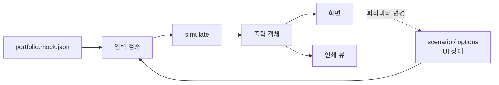

# 대체투자 현금흐름 시뮬레이션 대시보드 — 설계 문서

| 항목 | 내용 |
|---|---|
| 문서 버전 | v0.3 |
| 대상 | KIC BMT 과제 ② 대체투자 시뮬레이션 대시보드 구성 |
| 작성 목적 | Claude Code 개발 착수용 설계 기준 문서 |
| 상태 표기 | **[확정]** 합의 완료 · **[권장]** 권장안 반영, 최종 확인 필요 |
| 원문 기준 | 부록 A (BMT 안내문 과제 ② 원문 전문). 본문 1장은 요약이며, 충돌 시 부록 A가 우선 |

### 변경 이력

| 버전 | 내용 |
|---|---|
| v0.1 | 최초 작성 |
| v0.2 | BMT 원문 대조 검수 반영. 원문 전문을 부록 A로 수록, 과제 배경 추가. 표시 시간축 연속화(F), 실현/추정 2-스타일 및 인쇄 기준일 고정(G), AI 범위 정의(H), 기술 스택 확정(E). 슬라이더 단위 3%p·20%로 변경. 2페이지 x축 명시. 오프라인 빌드 추가. 실무 모드 기준점을 기준일로 변경(D 재정의) |
| v0.3 | 마일스톤 순서 조정: 기본 가정 대시보드(M3)를 민감도(M4)·불변 조건 테스트/실무 모드(M5)보다 먼저 구현. 16장 영향 마일스톤 갱신. 9장 출력 스키마 보강(`funds`, `steps`, `kpi.byClass`·`byFund`), 6장 검증 위치 명시 |

---

## 1. 과제 개요 (요약 — 원문은 부록 A)

### 1.1 목적
KIC가 다수의 대체자산 운용사(GP)에 출자한 펀드의 자금 유·출입(Capital Call / Distribution)과 NAV를
2017년부터 완전 회수 시점까지 시뮬레이션하고, 자산군별 IRR·MoIC 가정 변경에 따른 민감도를 보여주는 대시보드를 구현한다.

### 1.2 과제 배경
- 운용사는 LP의 펀드 약정 후 일정 기간 동안 투자금을 분할 집행하고 회수한다
- 운용사는 매분기 펀드투자 성과보고서를 LP에게 제공한다
- LP는 약정 후 10년간, 자금 회수 및 펀드 청산 시점까지 모니터링·관리한다
- KIC는 완전 회수 시점까지의 자금 유·출입 및 NAV를 "인공지능 시뮬레이션 모델"로 운용하고자 한다 (범위 정의는 3.6)

### 1.3 평가 요소
- 기술적 정합성 (수치, 대체자산 용어 이해)
- 요구 기능 유지 (Sensitivity Test)
- 사용자 편의성

### 1.4 원문 가정 요약 (부록 A 원문 1)
1. 매년 약정은 1월 1일
2. 약정금은 집행기간 동안 매년 균등 집행
3. 집행분은 gIRR로 NAV 상승
4. 집행분은 MoIC 달성 시점에 매각 회수
5. 관리보수: 약정금액 대비 집행기간 2%, 이후 1% / 성과보수: 회수 시점 20% / 직접투자는 보수 없음
6. XXX는 유일한 직접투자. 해당 연도 1월 1일 전액 집행, MoIC 달성 연도 회수
7. 대체자산 전체 + 자산군별(사모주식 PE / 부동산 RE / 인프라 Infra / 사모채권 PD) 구현
8. 자산군별 IRR·MoIC 가정 변경 시 모델 반영
9. 2017년부터 전액 회수 완료 시점까지 구현

### 1.5 원문 기술 요구사항 요약 (부록 A 원문 2)
- 2017년부터 완전 회수까지 NAV, 누적 Capital Call, 누적 Distribution 차트
- 2026년 9월까지 실현, 이후 추정
- 실현은 완전한 색상, 추정은 빗금 Shade
- 자산군별 IRR +3% / −3%씩 변경 시 회수기간 변동 (MoIC 고정, IRR↑ → 회수 단축)
- 자산군별 MoIC +20% / −20%씩 변경 시 회수기간 변동 (IRR 고정, MoIC↑ → 회수 연장)

### 1.6 제출물
- A4 2페이지 하드카피 10부 (제안발표일)
  - 1페이지: 대체 포트폴리오 전체 — 2017년부터 완전 회수까지 연도별 NAV, 누적 Capital Call, 누적 Distribution, IRR·MoIC 민감도
  - 2페이지: PE AAA VII — **약정 시점(2020년)부터** 완전 회수까지 동일 구성
- 발표 시 평가위원 요청에 따라 IRR·MoIC 가정 변경 → 결과 갱신 제시

### 1.7 입력 데이터 (Mock · 변경 금지 · 모델의 유일한 입력 데이터)

| 자산군 | 펀드명 | 약정($mn) | Vintage | 집행기간 | gIRR | Final gMOIC | 유형 |
|---|---|---:|---:|---|---:|---:|---|
| PE | AAA VI | 200 | 2017 | 4년 | 18% | 2.0x | fund |
| PE | AAA VII | 300 | 2020 | 4년 | 18% | 2.0x | fund |
| PE | BBB VIII | 200 | 2022 | 4년 | 18% | 2.0x | fund |
| PE | BBB IX | 300 | 2025 | 4년 | 18% | 2.0x | fund |
| PE | XXX | 400 | 2024 | 즉시 | 30% | 2.5x | direct |
| RE | CCC V | 200 | 2018 | 5년 | 12% | 1.6x | fund |
| RE | CCC VI | 300 | 2022 | 5년 | 12% | 1.6x | fund |
| Infra | DDD VI | 200 | 2015 | 6년 | 14% | 1.8x | fund |
| Infra | DDD VII | 200 | 2018 | 6년 | 14% | 1.8x | fund |
| Infra | EEE VI | 200 | 2020 | 6년 | 14% | 1.8x | fund |
| PD | FFF VI | 200 | 2023 | 3년 | 10% | 1.4x | fund |
| PD | FFF VII | 300 | 2026 | 3년 | 10% | 1.4x | fund |
| | **합계** | **3,000** | | | | | |

---

## 2. 용어

| 용어 | 정의 |
|---|---|
| 약정 (Commitment) | LP가 펀드에 출자하기로 약속한 총액 |
| 집행분 (Tranche) | 약정금 중 특정 연도 1월 1일에 집행되는 한 덩어리 |
| Capital Call | LP가 실제 납입하는 금액 (본 모델: 투자금 + 관리보수) |
| Distribution | LP에게 돌아오는 금액 (본 모델: 회수 총액 − 성과보수) |
| NAV | 미회수 집행분의 평가가치 합계 |
| t\* | 집행분이 MoIC에 도달하는 데 걸리는 기간(년) |
| 연 소수 시각 | 시점을 연도 + 경과 비율로 표현한 값. 예: 2026-09-30 → 2026 + 272/365 ≈ 2026.745 |
| DPI | 누적 Distribution / 누적 Capital Call |
| TVPI | (누적 Distribution + NAV) / 누적 Capital Call |

---

## 3. 해석 결정사항

원문에 정하지 않은 세부사항은 재량이되 상세한 근거를 제시해야 한다(부록 A). 아래 결정은 화면과 인쇄물의 "가정 명세"에 그대로 기재한다.

### 3.1 모델 기본 규칙

| # | 항목 | 결정 | 근거 | 상태 |
|---|---|---|---|---|
| 1 | 계산 단위 | 연 단위. 모든 약정·집행·관리보수는 1월 1일 발생 | 가정 1·2, 가정 6 "MOIC 달성 년도", 제출물 "연도별" | [확정] |
| 2 | 회수 시각 | 투자 시각 + t\* (연 소수 시각) | 가정 4 "MoIC 달성 시점" | [확정] |
| 3 | 회수 연도 | ⌊회수 시각⌋ = 투자 연도 + ⌊t\*⌋ | 가정 6 "달성 년도" | [확정] |
| 4 | 회수 금액 | 원금 × MoIC (정확값) | 가정 4 | [확정] |
| 5 | 계산 시작 | 2015년(DDD VI Vintage)부터 계산, 2017년부터 표시 | 가정 9와 DDD VI 2015 빈티지 양립 | [확정] |
| 6 | 누적값 기준 | 최초 약정 시점부터 누적 (2017년에 초기화하지 않음) | 초기화 시 DDD VI 회수가 Call보다 커 보이는 왜곡 | [확정] |
| 7 | 표시 시간축 (F) | NAV는 연도별 막대(연말 값). 누적 Call·Distribution은 **실제 발생 시각에 계단형** 선 | 연도 버킷만으로는 일부 민감도(PE IRR −3%p, XXX IRR ±3%p)에서 회수 연도가 변하지 않아 원문 "회수기간도 변동"과 충돌. 연도별 값은 계산 규칙 1~4와 동일 | [확정] |

### 3.2 실현 / 추정 표현 (G)

| 항목 | 결정 | 상태 |
|---|---|---|
| 스타일 | 원문대로 2가지만: 실현 = 완전 색상, 추정 = 빗금 Shade | [확정] |
| 경계 | 기준일의 연 소수 시각 위치 | [확정] |
| 누적 선 | 기준일 이전 실선, 이후 점선. 기준일 이후 영역에 빗금 배경 Shade | [확정] |
| NAV 막대 | 연말 시각(y + 1)이 기준일 이하이면 채움, 초과이면 빗금 | [확정] |
| 기준일 (화면) | 파라미터. 기본값 오늘, 수동 지정 가능 | [확정] |
| 기준일 (인쇄) | **2026-09-30 고정** (원문 "2026년 9월"을 9월 말로 해석) | [확정] |
| 진행 연도 | 차트 스타일에는 쓰지 않음. KPI·표 라벨에서만 "진행" 표기 | [확정] |

기준일 2026-09-30의 결과: 2025년 이전 NAV 막대는 채움, 2026년 이후는 빗금. 누적 선은 2026.745에서 스타일이 바뀐다.

### 3.3 민감도

| # | 항목 | 결정 | 상태 |
|---|---|---|---|
| 1 | IRR ±3% | %p 가감 (18% → 15% / 21%) | [확정] |
| 2 | MoIC ±20% | 상대 변동 (2.0x → 1.6x / 2.4x) | [확정] |
| 3 | 해석 전환 | 설정에서 IRR 상대 변동 / MoIC 절대 가감으로 전환 가능 | [확정] |
| 4 | XXX 적용 | PE 조정을 XXX에도 동일 폭 적용 (분리 옵션 제공) | [확정] |
| 5 | 동시 변경 | IRR·MoIC 동시 조정 지원 | [확정] |
| 6 | 민감도 모드 | 전 구간 재계산(기본) / 실무 모드(기준일 이전 고정) 토글 | [확정] |
| 7 | 조정 단위 | 원문 "±3%씩", "±20%씩" → IRR 3%p 단위(−6/−3/0/+3/+6), MoIC 20% 단위(−40/−20/0/+20/+40) | [확정] |
| A | 1페이지 적용 방식 | 전 자산군 동시 적용 | [권장] |
| C | 조정 하한 | 조정 후 IRR′ ≥ 1%, MoIC′ > 1.0x. 위반 단계는 비활성화하고 사유 표시 (예: PD·RE의 MoIC −40%) | [권장] |
| D | 실무 모드 기준점 | 기준일 시점을 기준으로 과거 고정, 이후 재계산 (7.7) | [권장] |

C의 근거: MoIC ≤ 1.0x인 손실 케이스의 성과보수 규칙이 원문에 없다.

### 3.4 보수

| 항목 | 결정 | 근거 | 상태 |
|---|---|---|---|
| 관리보수 재원 | 약정액과 별도의 추가 Capital Call | 가정 2: 약정금 전액이 균등 집행되어야 함 | [확정] |
| 관리보수 기준액 | 전 기간 약정액 | 원문 "약정금액 대비" | [확정] |
| 관리보수 요율 | V ≤ y < V + n: 2%, 이후 1% | 가정 5 | [확정] |
| 관리보수 기간 | Vintage 연도 ~ 해당 펀드 마지막 집행분 회수 연도 | 청산 시점까지 부과하는 실무 관행 | [확정] |
| 성과보수 방식 | 딜별: (회수 총액 − 원금) × 20% | 원문 "회수 시점에 20% 발생" | [확정] |
| 허들 / 캐치업 | 없음 | 원문 미기재 | [확정] |
| 성과보수 원가 | 투자원금만 (관리보수 미포함) | — | [확정] |
| 직접투자 | 관리보수·성과보수 0 | 가정 5·6 | [확정] |

### 3.5 NAV

| 항목 | 결정 | 상태 |
|---|---|---|
| 기본 | Gross NAV (미회수 집행분 평가가치 합) — 가정 3 | [확정] |
| 옵션 | Net NAV = Gross − 미실현 이익 × 20% (직투 제외) | [확정] |

### 3.6 AI 범위 (H)

| 항목 | 결정 | 상태 |
|---|---|---|
| 앱 내부 | 결정론적 시뮬레이션 엔진. LLM·외부 호출 없음 | [확정] |
| 근거 | 원문 가정 자체가 결정론적 규칙이며, 서버리스·외부 호출 금지 원칙 | [확정] |
| "인공지능 시뮬레이션 모델" 대응 | 발표·제안서에서 AI 에이전트가 이 엔진을 도구로 호출하는 구조(SFR-003 연계)로 설명. 엔진의 입력·출력 스키마가 도구 인터페이스 역할 | [확정] |

---

## 4. 아키텍처

### 4.1 원칙
- **서버리스**: mock 데이터를 받아 클라이언트에서 모든 계산 수행. 백엔드 없음
- **계층 분리**: 데이터 / 엔진(순수 함수) / 렌더링. 렌더링은 엔진 출력만 사용
- **원본 불변**: `portfolio`는 읽기 전용. 시나리오는 overlay로만 적용
- **오프라인 실행 가능**: 런타임 외부 리소스(CDN, 웹폰트, API) 없음

### 4.2 Flow



엔진 내부:


---

## 5. 입력 스키마

```json
{
  "portfolio": {
    "funds": [
      { "id": "AAA_VII", "assetClass": "PE", "name": "AAA VII",
        "type": "fund", "commitment": 300, "vintage": 2020,
        "investPeriod": 4, "gIRR": 0.18, "gMOIC": 2.0 }
    ],
    "fees": { "mgmtInvest": 0.02, "mgmtPost": 0.01, "carry": 0.20 }
  },
  "scenario": {
    "irrShift":  { "PE": 0, "RE": 0, "Infra": 0, "PD": 0 },
    "moicShift": { "PE": 0, "RE": 0, "Infra": 0, "PD": 0 }
  },
  "options": {
    "asOf": "2026-09-30",
    "irrShiftMode": "pp",
    "moicShiftMode": "relative",
    "applyToDirect": true,
    "sensitivityMode": "full",
    "navBasis": "gross",
    "calcStart": 2015,
    "displayStart": 2017
  }
}
```

| 필드 | 값 |
|---|---|
| `assetClass` | `PE` \| `RE` \| `Infra` \| `PD` |
| `type` | `fund` \| `direct` (direct는 `investPeriod: 1`) |
| `irrShift` | %p 단위 소수 (+3%p → `0.03`) |
| `moicShift` | 상대 비율 소수 (+20% → `0.20`) |
| `irrShiftMode` | `pp` \| `relative` |
| `moicShiftMode` | `relative` \| `absolute` |
| `sensitivityMode` | `full` \| `forward` |
| `navBasis` | `gross` \| `net` |

`portfolio.actuals`는 향후 실적 현금흐름 입력용으로 예약한다(15장).

---

## 6. 런타임 입력 검증 (앱 본문)

계산 직전에 매번 수행한다. 실패 시 계산하지 않고 화면에 오류를 표시한다.

- 필수 필드 존재 및 타입
- 펀드 12개, 약정 합계 = 3,000 (mock 무결성)
- `investPeriod` ≥ 1, `vintage` ≥ `calcStart`
- `type: direct` → 보수 0 처리
- 조정 후 IRR′ ≥ 1%, MoIC′ > 1.0x (3.3-C)
- `asOf` 유효 날짜

검증 위치 (v0.3): mock 무결성(펀드 12개·약정 3,000)은 앱 진입점에서 검사한다. `simulate` 내부 검증은 구조·범위 검사만 수행해, 11.2 무작위 입력(펀드 수·약정 임의)도 계산할 수 있게 한다. 두 검사 모두 계산 직전에 매번 수행하는 점은 같다.

---

## 7. 계산 엔진 `simulate(input) → output`

표기: A = 집행분 금액, V = Vintage, n = 집행기간, r = IRR, M = MoIC, τ_asOf = 기준일의 연 소수 시각

### 7.1 집행분 생성
- 펀드별 k = 0 … n − 1에 대해 A = commitment / n, 투자 연도 Y = V + k (투자 시각 = Y.0)
- direct는 n = 1

### 7.2 가정 조정
- `pp`: r′ = r + Δr / `relative`: r′ = r × (1 + Δr)
- `relative`: M′ = M × (1 + ΔM) / `absolute`: M′ = M + ΔM
- `applyToDirect: false`이면 direct는 조정하지 않음

### 7.3 집행분 계산 (전 구간 모드)
- t\* = ln(M′) / ln(1 + r′)
- 회수 시각 T = Y + t\*, 회수 연도 E = ⌊T⌋
- 시각 τ의 가치 = A × (1 + r′)^(τ − Y), Y ≤ τ < T
- 연말 NAV(y) = A × (1 + r′)^(y + 1 − Y), Y ≤ y < E / y ≥ E이면 0
- 회수 총액 = A × M′
- 성과보수 = carry × A × (M′ − 1) (direct는 0)
- 순회수 = 회수 총액 − 성과보수
- t\* < 1이면 E = Y (투자 연도 회수, 연말 NAV 0) — 정상 처리

### 7.4 관리보수 (펀드 단위)
- 기간: V ≤ y ≤ max(E) (해당 펀드 마지막 회수 연도)
- 요율: y < V + n이면 mgmtInvest, 아니면 mgmtPost
- 금액: commitment × 요율, 시각 y.0에 발생
- direct는 0

### 7.5 이벤트 및 집계
- 이벤트: `{ time, type: "call" | "fee" | "dist", fundId, amount }`
  - call, fee는 정수 시각(1월 1일), dist는 회수 시각 T
- 연도별 집계: 연도 y에 속한 이벤트 합 → callInvest, callFee, dist / 연말 NAV / 누적값
- 단위: 펀드별 / 자산군별 / 전체 동시 산출
- 누적은 `calcStart`부터

### 7.6 구간 판정
- 연도 라벨: y < ⌊τ_asOf⌋ → `past`, y = ⌊τ_asOf⌋ → `current`, y > ⌊τ_asOf⌋ → `future` (KPI·표 표기용)
- 차트 스타일: 3.2 규칙 (NAV 막대는 y + 1 ≤ τ_asOf이면 실현, 선은 τ_asOf 기준)

### 7.7 실무 모드 (`sensitivityMode: forward`)
- 기본 가정 기준 회수 시각 T_base ≤ τ_asOf인 집행분: 기본 가정 결과로 고정
- 투자 시각 ≤ τ_asOf < T_base인 집행분:
  - 기준일 가치 N₀ = A × (1 + r)^(τ_asOf − Y) (기본 r)
  - 기준일 이후 N₀ × (1 + r′)^(τ − τ_asOf)로 성장
  - 잔여 기간 τ_r = ln(A × M′ / N₀) / ln(1 + r′), 회수 시각 T = τ_asOf + τ_r
  - N₀ ≥ A × M′ (τ_r ≤ 0)이면 τ_asOf에 N₀로 회수 (3.3-D)
  - 성과보수 = carry × (회수 총액 − A)
- 투자 시각 > τ_asOf인 집행분: 전 구간 모드와 동일
- 기준일 이전 연말 NAV·이벤트는 기본 가정 결과와 일치해야 함

---

## 8. 시나리오 실행 `runScenarios(input, variants)`

인쇄용 5개 시나리오 (전 자산군 동시 적용, 3.3-A):

| 키 | irrShift | moicShift |
|---|---|---|
| `base` | 0 | 0 |
| `irrDown` | −0.03 | 0 |
| `irrUp` | +0.03 | 0 |
| `moicDown` | 0 | −0.20 |
| `moicUp` | 0 | +0.20 |

- 비교 차트의 x축 끝은 5개 시나리오 `endYear`의 최댓값으로 통일
- 화면에서는 자산군별 개별 조정 가능

---

## 9. 출력 스키마

```json
{
  "meta": { "asOf": "2026-09-30", "asOfTime": 2026.745, "asOfYear": 2026,
            "calcStart": 2015, "displayStart": 2017, "endYear": 2032 },
  "funds": [
    { "id": "AAA_VII", "name": "AAA VII", "assetClass": "PE", "type": "fund",
      "commitment": 300, "vintage": 2020, "investPeriod": 4,
      "gIRR": 0.18, "gMOIC": 2.0, "irr": 0.18, "moic": 2.0, "lastExitYear": 2027 }
  ],
  "tranches": [
    { "fundId": "AAA_VII", "investYear": 2020, "amount": 75,
      "irr": 0.18, "moic": 2.0, "tStar": 4.19,
      "exitTime": 2024.19, "exitYear": 2024,
      "exitGross": 150, "carry": 15, "exitNet": 135, "locked": false }
  ],
  "events": [
    { "time": 2024.19, "type": "dist", "fundId": "AAA_VII", "amount": 135 }
  ],
  "series": {
    "total":   [ { "year": 2024, "phase": "past",
                   "callInvest": 0, "callFee": 0, "dist": 0, "nav": 0,
                   "cumCall": 0, "cumDist": 0 } ],
    "byClass": { "PE": [], "RE": [], "Infra": [], "PD": [] },
    "byFund":  { "AAA_VII": [] }
  },
  "steps": {
    "total":   [ { "time": 2015, "cumCall": 0, "cumDist": 0 } ],
    "byClass": { "PE": [], "RE": [], "Infra": [], "PD": [] },
    "byFund":  { "AAA_VII": [] }
  },
  "kpi": {
    "total":   { "cumCall": 0, "cumDist": 0, "nav": 0, "dpi": 0, "tvpi": 0 },
    "byClass": { "PE": {}, "RE": {}, "Infra": {}, "PD": {} },
    "byFund":  { "AAA_VII": {} }
  },
  "errors": []
}
```

`series`의 수치는 구조 예시이며 실제 값이 아니다.

- `kpi`는 기준일 시각 기준 (누적 이벤트 합, 기준일 시점 평가가치)
- `series`는 `calcStart`부터 `endYear`까지 전 연도를 포함하며, 표시 범위는 렌더링에서 자름
- `locked`: 실무 모드에서 고정된 집행분 여부

v0.3 보강 (추가 필드만, 기존 필드 변경 없음). 10.1 보기 범위(전체/자산군/펀드)별 화면을 렌더링 재계산 없이 그리기 위함(4.1 계층 분리):

- `funds`: 펀드 표시 정보. `gIRR`·`gMOIC`는 원 가정, `irr`·`moic`는 조정 후 적용값(7.2), `lastExitYear`는 마지막 집행분 회수 연도(7.4 관리보수 종료 연도)
- `steps`: 누적 Call·Distribution 계단형 선(3.1-7) 데이터. 이벤트 발생 시각마다 해당 시각 이벤트까지 반영한 누적값. 첫 점은 `calcStart` 시각의 0
- `kpi.byClass`, `kpi.byFund`: 보기 범위별 KPI (정의는 `kpi.total`과 동일)
- 오류 시(`errors` 비어 있지 않음) 나머지 필드는 빈 값이며 렌더링하지 않는다

---

## 10. 렌더링

### 10.1 화면
- 보기 범위 선택: 전체 / 자산군 / 펀드
- KPI 카드: 누적 Call, 누적 Distribution, NAV, DPI, TVPI (기준일 시점, "진행 연도" 라벨)
- 메인 차트: NAV 연도별 막대 + 누적 Call·Distribution 계단형 선 (3.1-7, 3.2)
- 자산군별 IRR·MoIC 단계 선택 (3.3-7) + 하한 위반 단계 비활성화 (3.3-C)
- 설정 패널: 기준일, 민감도 모드, 해석 옵션, XXX 연동, NAV 기준
- 집행분 상세표: t\*, 회수 시각, 회수 연도, 회수 총액·성과보수·순회수
- 가정 명세 패널: 3장 결정사항

### 10.2 인쇄 (A4 가로 2페이지, `@media print`)
- 기준일 2026-09-30 고정 (3.2)
- 1페이지: 전체 포트폴리오, x축 2017 ~ 최대 endYear
- 2페이지: AAA VII, x축 **2020** ~ 최대 endYear (약정 시점부터)
- 페이지당 2행 × 3열 소형 차트 (행: IRR / MoIC, 열: 하향 / 기본 / 상향), 공통 축 (3.3-A와 함께 [권장])
- 기준일, 적용 가정, 가정 명세 요약 명기
- 흑백 인쇄 대응: 색상 외에 빗금 패턴·선 스타일로 구분

### 10.3 차트 구현
- SVG 직접 렌더링 (빗금은 `<pattern>`)
- 시간축은 연 소수 시각 연속축, 눈금은 연도 단위
- 렌더링 모듈은 출력 객체만 참조
- 시스템 폰트 스택 사용 (웹폰트 미사용, 4.1 오프라인 원칙)

---

## 11. 테스트 (빌드 단계, 배포 미포함)

### 11.1 정답 케이스 (고정 입력, 기준일 2026-09-30, 전 구간 모드)

**AAA VII (기본)**

| 항목 | 기대값 |
|---|---|
| 2020 집행분 연말 NAV 2020~2023 | 88.50 / 104.43 / 123.23 / 145.41 |
| 집행분 회수 시각 | 2024.19 / 2025.19 / 2026.19 / 2027.19 |
| 집행분 회수 연도 | 2024 / 2025 / 2026 / 2027 |
| 집행분 순회수 | 135 (150 − 15) |
| 누적 Distribution | 540 |
| 관리보수 | 2020~2023 연 6, 2024~2027 연 3 → 36 |
| 누적 Capital Call | 336 |

**XXX (기본)**

| 항목 | 기대값 |
|---|---|
| 투자 | 2024년 400 |
| t\* / 회수 시각 / 회수 연도 | 3.49 / 2027.49 / 2027 |
| 연말 NAV 2024~2026 | 520.0 / 676.0 / 878.8 |
| 회수 | 1,000 (보수 0) |

**DDD VI 2016년 말 누적**

| 항목 | 기대값 |
|---|---|
| 누적 투자 Call | 66.67 |
| 누적 관리보수 | 8.00 |
| NAV | 81.32 |

**포트폴리오 종료 연도**

| 시나리오 | endYear |
|---|---|
| 기본 | 2032 |
| 5개 시나리오 최대 | 2033 |

**회수 시각 이동 (3.1-7 검증)**

| 케이스 | 기본 t\* → 변경 t\* |
|---|---|
| PE IRR −3%p | 4.19 → 4.96 (회수 연도 동일, 회수 시각 이동) |
| XXX IRR +3%p | 3.49 → 3.21 |
| XXX IRR −3%p | 3.49 → 3.83 |

### 11.2 불변 조건 (무작위 입력 포함 전 입력)
- 누적 투자 Call 총합 = 약정 합계 (시나리오 무관)
- 각 집행분 회수 총액 = A × M′ (실무 모드 초과 케이스는 ≥)
- 성과보수 = carry × (회수 총액 − A), direct는 0
- 최종 연도 NAV = 0, 최종 누적 Distribution = Σ 순회수
- 연도별 집계 = 해당 연도 이벤트 합
- 자산군 합 = 전체 (모든 연도, 모든 필드)
- 모든 수치 ≥ 0
- 실무 모드: 기준일 이전 이벤트·연말 NAV = 기본 가정 결과

### 11.3 변환 관계
- 비례성: 약정 ×k → Call·Distribution·NAV·보수 ×k
- 합산성: simulate(A∪B) = simulate(A) + simulate(B)
- 시간 이동: Vintage +1 → 해당 펀드 이벤트 시각·원시 시계열 +1 (구간 판정, 표시 시작 제외)
- 방향성: r′↑ → 회수 시각 단축 / M′↑ → 회수 시각 연장 (연도가 아니라 시각 기준, 엄격 부등호)

### 11.4 한계
- 해석 오류는 테스트로 잡히지 않음 → 3장 결정사항 검토로 관리
- 입력에 새 개념(손실 펀드, 허들 등) 추가 시 규칙과 테스트를 함께 정의

---

## 12. 참고: 회수 기간

t\* = ln(M′) / ln(1 + r′) (년), 괄호는 ⌊t\*⌋

| 자산군 | 기본 | IRR −3%p | IRR +3%p | MoIC −20% | MoIC +20% |
|---|---|---|---|---|---|
| PE | 4.19 (4) | 4.96 (4) | 3.64 (3) | 2.84 (2) | 5.29 (5) |
| XXX | 3.49 (3) | 3.83 (3) | 3.21 (3) | 2.64 (2) | 4.19 (4) |
| RE | 4.15 (4) | 5.45 (5) | 3.36 (3) | 2.18 (2) | 5.76 (5) |
| Infra | 4.49 (4) | 5.63 (5) | 3.74 (3) | 2.78 (2) | 5.88 (5) |
| PD | 3.53 (3) | 4.97 (4) | 2.75 (2) | 1.19 (1) | 5.44 (5) |

모든 케이스에서 t\*는 변한다. 연도 버킷이 같은 칸(PE IRR −3, XXX IRR ±3)도 3.1-7의 계단형 선에서 회수 시각 이동이 표시된다.

---

## 13. 기술 스택 및 저장소 구조 [확정]

| 항목 | 결정 |
|---|---|
| 빌드 | Vite |
| 언어 | TypeScript strict (프레임워크 없음) |
| 테스트 | Vitest + fast-check |
| 차트 | SVG 직접 렌더링 |
| 오프라인 빌드 | vite-plugin-singlefile (단일 HTML) [권장] |
| 배포 | Vercel 정적 배포 (`dist/`) |

```
/
├── CLAUDE.md
├── docs/
│   └── DESIGN.md
├── src/
│   ├── data/portfolio.mock.json
│   ├── engine/
│   │   ├── types.ts
│   │   ├── time.ts
│   │   ├── validate.ts
│   │   ├── tranches.ts
│   │   ├── fees.ts
│   │   ├── aggregate.ts
│   │   ├── simulate.ts
│   │   └── scenarios.ts
│   ├── ui/
│   │   ├── charts/
│   │   ├── controls/
│   │   └── print/
│   └── main.ts
├── tests/
│   ├── golden.test.ts
│   ├── invariants.test.ts
│   └── metamorphic.test.ts
├── index.html
├── package.json
└── vite.config.ts
```

---

## 14. 개발 및 배포 워크플로

1. 설계: 본 문서 기준으로 Claude와 결정, 문서 개정
2. 저장소: 본 문서를 `docs/DESIGN.md`로 포함, Claude Code에서 구현
3. 로컬 개발: `npm run dev` / `npm test`, 마일스톤 단위 커밋
4. 배포: Vercel 빌드 명령 `npm test && npm run build` (테스트 실패 시 배포 중단)
5. 발표 백업: `npm run build:offline`으로 단일 HTML 생성, 인터넷 없이 브라우저에서 실행

### 마일스톤

| # | 내용 | 완료 기준 |
|---|---|---|
| M1 | 프로젝트 구성, mock 데이터, 타입 정의 | 빌드·빈 테스트 성공 |
| M2 | 엔진 7.1~7.6 (7.2 가정 조정 포함) + 입력 검증 | 11.1 정답 케이스 통과 |
| M3 | 기본 대시보드: 기본 가정 화면 (보기 범위, KPI, 메인 차트, 기준일, 연도별 표, 집행분 상세표, 가정 명세) | mock 기본값으로 전체·자산군·펀드 화면 표시, 3.2 스타일 확인 |
| M4 | 민감도: 자산군별 IRR·MoIC 단계 선택(3.3-7, 3.3-C), 설정 패널, 시나리오 실행(8장) | 조작 즉시 반영, 11.1 회수 시각 이동 케이스 화면 확인 |
| M5 | 불변 조건·변환 관계 테스트 + 실무 모드 7.7 | 11.2·11.3 통과, 실무 모드 불변 조건 통과 |
| M6 | 인쇄 뷰 | A4 2페이지, 흑백 출력 확인 |
| M7 | Vercel 배포 + 오프라인 빌드 | 보호된 URL 접근, 단일 HTML 오프라인 실행 |

순서 근거 (v0.3): 현재 mock 기본값으로 요구 차트를 구현할 수 있음을 먼저 확인한다. 민감도는 원문 평가 요소(1.3 "요구 기능 유지")이므로 순서만 뒤로 두고 생략하지 않는다. 가정 조정 계산(7.2)은 조정값 0 = 기본값 검증이 가능하도록 M2 엔진에 포함한다.

### 배포 시 유의
BMT mock 데이터는 KIC 제공 자료이다. Vercel 배포 시 공개 접근이 되지 않도록 Deployment Protection을 적용한다. GitHub 저장소도 비공개로 한다.

---

## 15. 향후 확장

- `portfolio.actuals`: GP 보고서 실적 현금흐름 입력. 과거는 실적, 미래는 시뮬레이션 → KIC 실환경 연계
- AI 에이전트 도구 연동: `simulate`를 도구로 노출 (3.6)
- CSV 내보내기 (사용자 편의, 선택)

---

## 16. 미결 사항

| # | 항목 | 현재 반영 | 영향 마일스톤 |
|---|---|---|---|
| C | 조정 하한 | IRR′ ≥ 1%, MoIC′ > 1.0x, 위반 단계 비활성화 | M2·M4 |
| A | 1페이지 민감도 적용 방식 | 전 자산군 동시 적용 | M4 |
| D | 실무 모드 기준점 | 기준일 시각 기준 (7.7) | M5 |
| B | 인쇄 차트 구성 | 2행 × 3열 소형 차트 | M6 |
| Q | KIC 질의: 안내문 과제 ② 목차가 3 → 5로 건너뜀 (4번 누락 여부) | — | — |

---

## 부록 A. BMT 안내문 과제 ② 원문

PDF 텍스트 추출본 기준. 줄바꿈과 숫자 사이 공백만 정리했으며 문구는 변경하지 않았다. 원 문서의 섹션 번호를 그대로 유지했다(4번 없음).

**[과제 2 – 대체투자 시뮬레이션 대시보드 구성]**

**1. 테스트 개요**

과제 ②는 공사 포트폴리오 중 대체 자산과 관련한 Task 능력을 파악하기 위한 테스트입니다.
- 평가 요소: 기술적 정합성(수치·대체자산 용어 이해 등)과 요구 기능 유지(Sensitivity Test), 사용자 편의성

**2. 과제 정의 및 배경**

작성 대상은 대체 투자 포트폴리오 현금흐름 시뮬레이션 모델 대시보드 구성입니다. 아래의 내용을 참고해서 테스트를 실행해주시길 바랍니다.
- 대체자산 운용사는 LP 투자자의 펀드 약정 후 일정기간 동안 투자금을 분할 집행 & 회수
- 운용사는 매분기마다 투자 활동을 정리하여 펀드투자 성과 보고서를 LP 투자자에게 제공
- LP 투자자는 펀드 약정 후 10년간 자금 회수 및 펀드 청산 시점까지 모니터링 및 관리
- KIC는 다수의 대체자산 운용사들에 복수의 펀드를 출자하고, 투자 후 투자금 완전 회수 시점까지 자금의 유·출입 및 NAV를 인공지능 시뮬레이션 모델을 운용하고자 함

**3. 시뮬레이션 모델 가정 (원문 · 변경 금지)**

다음의 원문은 임의로 변경할 수 없습니다. 원문에 정하지 않은 세부사항은 제안사의 재량에 따라 작성하지만 상세한 근거를 제공하여야 합니다.

<원문 1>
- 가정 1. 펀드에 매년도 약정된 투자금은 매년 1월 1일 펀드 약정 가정
- 가정 2. 펀드 약정금은 투자금 집행기간 동안 매년 균등 집행 가정 (4년이면 25%씩, 5년이면 20%씩 매년 집행 가정)
- 가정 3. 매년 집행된 투자금은 자산별 gIRR에 따라 NAV 가치 상승 가정
- 가정 4. 매년도 집행된 펀드 투자금은 MoIC 달성 시점에 매각 회수되는 것으로 가정
- 가정 5. 펀드 투자는 매년 약정금액 대비 2% 관리보수가 반영되고, 성과보수는 회수 시점에 20% 발생 가정(관리보수는 투자금 집행기간 동안은 2%, 집행기간 이후로는 1%로 하향 적용), 직접투자는 관리보수 및 성과보수가 없음
- 가정 6. 펀드 XXX 건은 유일한 직접투자 건으로 해당 년도 1월 1일에 전액 집행되고, MOIC 달성 년도 회수 가정
- 가정 7. 시뮬레이션 모델은 대체 자산 전체로 구현해야 하며, 사모주식/부동산/인프라/사모채권 등 자산군 별로도 구현되어야 함
- 가정 8. 시뮬레이션 모델은 자산군별 펀드 IRR 가정, MOIC 가정을 변경하면 시뮬레이션 모델이 이를 반영하여 변경되어야 함
- 가정 9. 시뮬레이션 모델은 2017년부터 전액 자금 회수가 완료되는 시점까지 구현되어야 함

**5. 대체 투자 포트폴리오 샘플 (Mock · 변경 금지)**

표 안의 데이터는 모델의 유일한 입력 데이터이며 임의로 변경할 수 없습니다.

| 자산군 | 펀드명 | 금액(단위: $mn) | Vintage | 투자금 집행기간 | gIRR | Final gMOIC |
|---|---|---:|---:|---|---:|---:|
| PE | AAA VI | 200 | 2017 | 4년 | 18% | 2.0x |
| PE | AAA VII | 300 | 2020 | 4년 | 18% | 2.0x |
| PE | BBB VIII | 200 | 2022 | 4년 | 18% | 2.0x |
| PE | BBB IX | 300 | 2025 | 4년 | 18% | 2.0x |
| PE | XXX | 400 | 2024 | 즉시 | 30% | 2.5x |
| RE | CCC V | 200 | 2018 | 5년 | 12% | 1.6x |
| RE | CCC VI | 300 | 2022 | 5년 | 12% | 1.6x |
| Infra | DDD VI | 200 | 2015 | 6년 | 14% | 1.8x |
| Infra | DDD VII | 200 | 2018 | 6년 | 14% | 1.8x |
| Infra | EEE VI | 200 | 2020 | 6년 | 14% | 1.8x |
| PD | FFF VI | 200 | 2023 | 3년 | 10% | 1.4x |
| PD | FFF VII | 300 | 2026 | 3년 | 10% | 1.4x |
| Total | | 3,000 | | | | |

**6. 기술적 구현내용 (원문 · 변경 금지)**

다음의 원문은 임의로 변경할 수 없습니다. 원문에 정하지 않은 세부사항은 제안사의 재량에 따라 작성하지만 상세한 근거를 제공하여야 합니다.

<원문 2>
- 2017년부터 투자금 완전 회수 시점까지 NAV, 누적 Capital Call & Distribution 차트 구현
- 2026년 9월까지는 실현된 시뮬레이션 모델, 2026년 9월부터 완전 회수시점까지는 추정 시뮬레이션 제공
- 실현된 시뮬레이션 모델은 완전한 색상 차트, 예상 시뮬레이션 모델은 빗금 Shade 표현
- 자산군별 IRR 가정이 +3%, 마이너스 -3%씩 변경하면 자산의 회수기간도 변동 (i.e. MoIC가 일정한데 IRR이 증가하면 자산의 회수기간이 짧아짐)
- 각 자산군별 IRR 가정 변경시 시뮬레이션 모델이 변경되는 기능을 구현
- 자산군별 MOIC 가정이 +20%, 마이너스 -20%씩 변경하면 자산의 회수기간도 변동 (i.e. IRR이 일정한데 MoIC 증가하면 자산의 회수기간이 길어짐)
- 각 자산군별 MoIC 가정 변경시 시뮬레이션 모델이 변경되는 기능을 구현

**7. 최종 결과물**

IRR 가정 Sensitivity Test와 MOIC 가정 Sensitivity Test를 시뮬레이션 모델 차트로 1페이지는 '대체 포트폴리오 전체', 2페이지는 'PE 포트폴리오 AAA VII' 내용으로 2장짜리 결과물을 총 10부의 하드카피로 제안발표일에 제출해주세요.
- 대체 포트폴리오 전체의 2017년부터 완전 회수 시점까지 연도별 NAV, 누적 Capital Call, 누적 Distribution 시뮬레이션 모델
- PE 포트폴리오 AAA VII 펀드의 약정 시점부터 완전 회수 시점까지 연도별 NAV, 누적 Capital Call, 누적 Distribution 시뮬레이션 모델

※ 제안발표 시 IRR·MoIC 가정을 변경하도록 평가위원이 요청하면 시뮬레이션 모델의 정보가 갱신됨을 제시하여야 함
