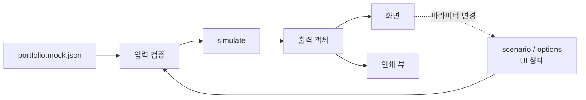

# 대체투자 현금흐름 시뮬레이션 대시보드 — 설계 문서

| 항목 | 내용 |
|---|---|
| 문서 버전 | v0.9 |
| 대상 | KIC BMT 과제 ② 대체투자 시뮬레이션 대시보드 구성 |
| 작성 목적 | Claude Code 개발 착수용 설계 기준 문서 |
| 상태 표기 | **[확정]** 합의 완료 · **[권장]** 권장안 반영, 최종 확인 필요 |
| 원문 기준 | 부록 A (BMT 안내문 과제 ② 원문 전문). 본문 1장은 요약이며, 충돌 시 부록 A가 우선 |

### 변경 이력

| 버전 | 내용 |
|---|---|
| v0.1 | 최초 작성 |
| v0.2 | BMT 원문 대조 검수 반영. 원문 전문을 부록 A로 수록, 과제 배경 추가. 표시 시간축 연속화(F), 실현/추정 2-스타일 및 인쇄 기준일 고정(G), AI 범위 정의(H), 기술 스택 확정(E). 슬라이더 단위 3%p·20%로 변경. 2페이지 x축 명시. 오프라인 빌드 추가. 실무 모드 기준점을 기준일로 변경(D 재정의) |
| v0.3 | 마일스톤 순서 조정: 기본 가정 대시보드(M3)를 민감도(M4)·불변 조건 테스트/실무 모드(M5)보다 먼저 구현. 16장 영향 마일스톤 갱신. 9장 출력 스키마 보강(`funds`, `steps`, `kpi.byClass`·`byFund`), 6장 검증 위치 명시 |
| v0.4 | 마일스톤 순서 조정: 인쇄 뷰(M5)를 불변 조건 테스트·실무 모드(M6)보다 먼저 구현. 16장 영향 마일스톤 갱신. 10.1 화면 보강(범위별 x축, 기본 가정 비교 표시, 자산군별 조정, 시나리오 요약 표). 인쇄 2페이지 x축은 10.2대로 최대 endYear(2033) 확정 |
| v0.5 | 실무 모드(7.7)를 M5로 앞당겨 인쇄에 적용(기준일 이전 실현 구간이 시나리오마다 달라지지 않도록). 인쇄 시나리오 해석 기본값 고정, 페이지별 시나리오 요약 표 추가. 9장 Tranche에 가치 경로 필드(`preIrr`, `anchorTime`, `anchorValue`) 추가 |
| v0.6 | 인쇄 2페이지(AAA VII)는 전 구간 재계산으로 인쇄(회수기간 변동 표시), 요약 표 "기준일 TVPI" → "마지막 회수 시각". 3.3-D 기준일 회수를 기준일 직후(추정)로 처리. 9장 `lastExit` 추가 |
| v0.7 | 원문 기준 재검토: 인쇄 두 페이지 모두 전 구간 재계산(화면 기본과 동일, 실무 모드는 화면 토글만). 2페이지 x축은 원문 "약정 시점부터 완전 회수 시점까지"에 따라 AAA VII 시나리오 최대 종료 연도까지. KPI는 "기준일 NAV", 표는 "연말 NAV"로 구분. 가정 명세에 민감도 해석 명기. 화면 사용 가이드 추가 |
| v0.8 | UI/UX 재정돈(M8): 2단 배치(조작 사이드바 + 결과), 대표 수치 기준일 NAV, 표 탭, KIC 스타일 디자인 토큰. 인쇄 머리·열 머리·축 라벨 중복 제거·기본 대비 차이. 8장 시나리오 요약 출력 |
| v0.9 | 사용자 피드백 3건(M9): ① 회수를 분기 단위(MoIC 도달 분기의 분기말)로 인식, 기준일은 직전 분기말까지 실현 ② 펀드·자산군·전체별 예상 최종 Net IRR·MoIC ③ 관리보수를 약정 안에서 충당(투자금 = 약정 − 총보수), 최종 누적 Call = 약정. 실무 모드(7.7) 제거. 11.1 정답 케이스 재산정 |

---

## 1. 과제 개요 (요약 — 원문은 부록 A)

### 1.1 목적
KIC가 다수의 대체자산 운용사(GP)에 출자한 펀드의 자금 유·출입(Capital Call / Distribution)과 NAV를
2017년부터 완전 회수 시점까지 시뮬레이션하고, 자산군별 IRR·MoIC 가정 변경에 따른 민감도를 보여주는 대시보드를 구현한다.

### 1.2 과제 배경
- 운용사는 LP의 펀드 약정 후 일정 기간 동안 투자금을 분할 집행하고 회수한다
- 운용사는 매분기 펀드투자 성과보고서를 LP에게 제공한다
- LP는 약정 후 10년간, 자금 회수 및 펀드 청산 시점까지 모니터링·관리한다
- KIC는 완전 회수 시점까지의 자금 유·출입 및 NAV를 "인공지능 시뮬레이션 모델"로 운용하고자 한다 (범위 정의는 3.6)

### 1.3 평가 요소
- 기술적 정합성 (수치, 대체자산 용어 이해)
- 요구 기능 유지 (Sensitivity Test)
- 사용자 편의성

### 1.4 원문 가정 요약 (부록 A 원문 1)
1. 매년 약정은 1월 1일
2. 약정금은 집행기간 동안 매년 균등 집행
3. 집행분은 gIRR로 NAV 상승
4. 집행분은 MoIC 달성 시점에 매각 회수
5. 관리보수: 약정금액 대비 집행기간 2%, 이후 1% / 성과보수: 회수 시점 20% / 직접투자는 보수 없음
6. XXX는 유일한 직접투자. 해당 연도 1월 1일 전액 집행, MoIC 달성 연도 회수
7. 대체자산 전체 + 자산군별(사모주식 PE / 부동산 RE / 인프라 Infra / 사모채권 PD) 구현
8. 자산군별 IRR·MoIC 가정 변경 시 모델 반영
9. 2017년부터 전액 회수 완료 시점까지 구현

### 1.5 원문 기술 요구사항 요약 (부록 A 원문 2)
- 2017년부터 완전 회수까지 NAV, 누적 Capital Call, 누적 Distribution 차트
- 2026년 9월까지 실현, 이후 추정
- 실현은 완전한 색상, 추정은 빗금 Shade
- 자산군별 IRR +3% / −3%씩 변경 시 회수기간 변동 (MoIC 고정, IRR↑ → 회수 단축)
- 자산군별 MoIC +20% / −20%씩 변경 시 회수기간 변동 (IRR 고정, MoIC↑ → 회수 연장)

### 1.6 제출물
- A4 2페이지 하드카피 10부 (제안발표일)
  - 1페이지: 대체 포트폴리오 전체 — 2017년부터 완전 회수까지 연도별 NAV, 누적 Capital Call, 누적 Distribution, IRR·MoIC 민감도
  - 2페이지: PE AAA VII — **약정 시점(2020년)부터** 완전 회수까지 동일 구성
- 발표 시 평가위원 요청에 따라 IRR·MoIC 가정 변경 → 결과 갱신 제시

### 1.7 입력 데이터 (Mock · 변경 금지 · 모델의 유일한 입력 데이터)

| 자산군 | 펀드명 | 약정($mn) | Vintage | 집행기간 | gIRR | Final gMOIC | 유형 |
|---|---|---:|---:|---|---:|---:|---|
| PE | AAA VI | 200 | 2017 | 4년 | 18% | 2.0x | fund |
| PE | AAA VII | 300 | 2020 | 4년 | 18% | 2.0x | fund |
| PE | BBB VIII | 200 | 2022 | 4년 | 18% | 2.0x | fund |
| PE | BBB IX | 300 | 2025 | 4년 | 18% | 2.0x | fund |
| PE | XXX | 400 | 2024 | 즉시 | 30% | 2.5x | direct |
| RE | CCC V | 200 | 2018 | 5년 | 12% | 1.6x | fund |
| RE | CCC VI | 300 | 2022 | 5년 | 12% | 1.6x | fund |
| Infra | DDD VI | 200 | 2015 | 6년 | 14% | 1.8x | fund |
| Infra | DDD VII | 200 | 2018 | 6년 | 14% | 1.8x | fund |
| Infra | EEE VI | 200 | 2020 | 6년 | 14% | 1.8x | fund |
| PD | FFF VI | 200 | 2023 | 3년 | 10% | 1.4x | fund |
| PD | FFF VII | 300 | 2026 | 3년 | 10% | 1.4x | fund |
| | **합계** | **3,000** | | | | | |

---

## 2. 용어

| 용어 | 정의 |
|---|---|
| 약정 (Commitment) | LP가 펀드에 출자하기로 약속한 총액 |
| 집행분 (Tranche) | 약정금 중 특정 연도 1월 1일에 집행되는 한 덩어리 |
| Capital Call | LP가 실제 납입하는 금액 (본 모델: 투자금 + 관리보수) |
| Distribution | LP에게 돌아오는 금액 (본 모델: 회수 총액 − 성과보수) |
| NAV | 미회수 집행분의 평가가치 합계 |
| t\* | 집행분이 MoIC에 도달하는 데 걸리는 기간(년) |
| 연 소수 시각 | 시점을 연도 + 경과 비율로 표현한 값. 예: 2026-09-30 → 2026 + 272/365 ≈ 2026.745. v0.9부터 회수·평가 시점은 분기말(연도 + 분기/4)로만 쓰고, 연속값은 MoIC 도달 시각 T 계산에만 사용 |
| 분기 (qIndex) | 4 × 연도 + (분기 − 1). Q4 말과 다음 해 1월 1일은 같은 시각이므로 비교·집계는 시각이 아니라 qIndex로 한다 (v0.9) |
| 회수 분기 | MoIC 도달 시각 T가 속한 분기. 그 분기말(운용사 보고 시점)에 회수를 인식 (v0.9) |
| 기준 분기 | 기준일 이전 마지막 분기말(기준일이 분기말이면 그날)이 속한 분기. 이 분기까지 실현 (v0.9) |
| Net IRR / Net MoIC | LP 순현금흐름(−Call, +Distribution) 기준 수익률 / 총 Distribution ÷ 총 Call (v0.9) |
| DPI | 누적 Distribution / 누적 Capital Call |
| TVPI | (누적 Distribution + NAV) / 누적 Capital Call |

---

## 3. 해석 결정사항

원문에 정하지 않은 세부사항은 재량이되 상세한 근거를 제시해야 한다(부록 A). 아래 결정은 화면과 인쇄물의 "가정 명세"에 그대로 기재한다.

### 3.1 모델 기본 규칙

| # | 항목 | 결정 | 근거 | 상태 |
|---|---|---|---|---|
| 1 | 계산 단위 | 연 단위. 모든 약정·집행·관리보수는 1월 1일 발생 | 가정 1·2, 가정 6 "MOIC 달성 년도", 제출물 "연도별" | [확정] |
| 2 | 회수 시각 | 도달 시각 T = 투자 시각 + t\*. 회수는 **T가 속한 분기의 분기말**에 인식 (v0.9) | 가정 4 "MoIC 달성 시점" + 운용사 분기 보고 관행 (사용자 피드백) | [확정] |
| 3 | 회수 연도 | 회수 분기의 연도 (v0.9) | 가정 6 "달성 년도" | [확정] |
| 4 | 회수 금액 | 원금 × MoIC (정확값) | 가정 4 | [확정] |
| 5 | 계산 시작 | 2015년(DDD VI Vintage)부터 계산, 2017년부터 표시 | 가정 9와 DDD VI 2015 빈티지 양립 | [확정] |
| 6 | 누적값 기준 | 최초 약정 시점부터 누적 (2017년에 초기화하지 않음) | 초기화 시 DDD VI 회수가 Call보다 커 보이는 왜곡 | [확정] |
| 7 | 표시 시간축 (F) | NAV는 연도별 막대(연말 값). 누적 Call·Distribution은 **실제 발생 시점(1월 1일·분기말)에 계단형** 선 (v0.9) | 연도 버킷만으로는 일부 민감도(PE IRR −3%p, XXX IRR ±3%p)에서 회수 연도가 변하지 않아 원문 "회수기간도 변동"과 충돌. 연도별 값은 계산 규칙 1~4와 동일 | [확정] |

### 3.2 실현 / 추정 표현 (G)

| 항목 | 결정 | 상태 |
|---|---|---|
| 스타일 | 원문대로 2가지만: 실현 = 완전 색상, 추정 = 빗금 Shade | [확정] |
| 경계 | **기준 분기말** (기준일 이전 마지막 분기말, 당일이 분기말이면 그날). 실현 = 기준 분기 이하 (v0.9) | [확정] |
| 누적 선 | 기준일 이전 실선, 이후 점선. 기준일 이후 영역에 빗금 배경 Shade | [확정] |
| NAV 막대 | 연말 시각(y + 1)이 기준일 이하이면 채움, 초과이면 빗금 | [확정] |
| 기준일 (화면) | 파라미터. 기본값 오늘, 수동 지정 가능 | [확정] |
| 기준일 (인쇄) | **2026-09-30 고정** (원문 "2026년 9월"을 9월 말로 해석) | [확정] |
| 진행 연도 | 차트 스타일에는 쓰지 않음. KPI·표 라벨에서만 "진행" 표기 | [확정] |

기준일 2026-09-30의 결과: 2025년 이전 NAV 막대는 채움, 2026년 이후는 빗금. 누적 선은 2026.745에서 스타일이 바뀐다.

### 3.3 민감도

| # | 항목 | 결정 | 상태 |
|---|---|---|---|
| 1 | IRR ±3% | %p 가감 (18% → 15% / 21%) | [확정] |
| 2 | MoIC ±20% | 상대 변동 (2.0x → 1.6x / 2.4x) | [확정] |
| 3 | 해석 전환 | 설정에서 IRR 상대 변동 / MoIC 절대 가감으로 전환 가능 | [확정] |
| 4 | XXX 적용 | PE 조정을 XXX에도 동일 폭 적용 (분리 옵션 제공) | [확정] |
| 5 | 동시 변경 | IRR·MoIC 동시 조정 지원 | [확정] |
| 6 | 민감도 모드 | 전 구간 재계산만 제공. 실무 모드(기준일 이전 고정)는 v0.9에서 제거 — 원문에 없고, 약정 내 보수(3.4)와 충돌(이미 집행한 금액을 바꿀 수 없음). 실적 데이터 연동(15장) 때 다시 설계 | [확정] |
| 7 | 조정 단위 | 원문 "±3%씩", "±20%씩" → IRR 3%p 단위(−6/−3/0/+3/+6), MoIC 20% 단위(−40/−20/0/+20/+40) | [확정] |
| A | 1페이지 적용 방식 | 전 자산군 동시 적용 | [권장] |
| C | 조정 하한 | 조정 후 IRR′ ≥ 1%, MoIC′ > 1.0x. 위반 단계는 비활성화하고 사유 표시 (예: PD·RE의 MoIC −40%) | [권장] |
| D | 실무 모드 기준점 | v0.9에서 실무 모드 제거로 삭제 | — |

C의 근거: MoIC ≤ 1.0x인 손실 케이스의 성과보수 규칙이 원문에 없다.

### 3.4 보수

| 항목 | 결정 | 근거 | 상태 |
|---|---|---|---|
| 관리보수 재원 | **약정액 안에서 충당** (v0.9). 펀드 전 기간 총보수 F를 먼저 계산하고, 투자금 (약정 − F)를 집행기간 동안 매년 균등 투자. 보수는 매년 1월 1일 Call. 펀드 Call 합계 = 약정 | 사용자 피드백: Call은 약정을 넘을 수 없음(보수 포함 약정). 보수 일정은 회수 분기에만 의존하고 금액과 무관해 순환 없이 계산 가능 | [확정] |
| 관리보수 기준액 | 전 기간 약정액 | 원문 "약정금액 대비" | [확정] |
| 관리보수 요율 | V ≤ y < V + n: 2%, 이후 1% | 가정 5 | [확정] |
| 관리보수 기간 | Vintage 연도 ~ 해당 펀드 마지막 집행분 회수 연도 | 청산 시점까지 부과하는 실무 관행 | [확정] |
| 성과보수 방식 | 딜별: (회수 총액 − 원금) × 20% | 원문 "회수 시점에 20% 발생" | [확정] |
| 허들 / 캐치업 | 없음 | 원문 미기재 | [확정] |
| 성과보수 원가 | 투자원금만 (관리보수 미포함) | — | [확정] |
| 직접투자 | 관리보수·성과보수 0 | 가정 5·6 | [확정] |

### 3.5 NAV

| 항목 | 결정 | 상태 |
|---|---|---|
| 기본 | Gross NAV (미회수 집행분 평가가치 합) — 가정 3 | [확정] |
| 옵션 | Net NAV = Gross − 미실현 이익 × 20% (직투 제외) | [확정] |

### 3.6 AI 범위 (H)

| 항목 | 결정 | 상태 |
|---|---|---|
| 앱 내부 | 결정론적 시뮬레이션 엔진. LLM·외부 호출 없음 | [확정] |
| 근거 | 원문 가정 자체가 결정론적 규칙이며, 서버리스·외부 호출 금지 원칙 | [확정] |
| "인공지능 시뮬레이션 모델" 대응 | 발표·제안서에서 AI 에이전트가 이 엔진을 도구로 호출하는 구조(SFR-003 연계)로 설명. 엔진의 입력·출력 스키마가 도구 인터페이스 역할 | [확정] |

---

## 4. 아키텍처

### 4.1 원칙
- **서버리스**: mock 데이터를 받아 클라이언트에서 모든 계산 수행. 백엔드 없음
- **계층 분리**: 데이터 / 엔진(순수 함수) / 렌더링. 렌더링은 엔진 출력만 사용
- **원본 불변**: `portfolio`는 읽기 전용. 시나리오는 overlay로만 적용
- **오프라인 실행 가능**: 런타임 외부 리소스(CDN, 웹폰트, API) 없음

### 4.2 Flow



엔진 내부:


---

## 5. 입력 스키마

```json
{
  "portfolio": {
    "funds": [
      { "id": "AAA_VII", "assetClass": "PE", "name": "AAA VII",
        "type": "fund", "commitment": 300, "vintage": 2020,
        "investPeriod": 4, "gIRR": 0.18, "gMOIC": 2.0 }
    ],
    "fees": { "mgmtInvest": 0.02, "mgmtPost": 0.01, "carry": 0.20 }
  },
  "scenario": {
    "irrShift":  { "PE": 0, "RE": 0, "Infra": 0, "PD": 0 },
    "moicShift": { "PE": 0, "RE": 0, "Infra": 0, "PD": 0 }
  },
  "options": {
    "asOf": "2026-09-30",
    "irrShiftMode": "pp",
    "moicShiftMode": "relative",
    "applyToDirect": true,
    "navBasis": "gross",
    "calcStart": 2015,
    "displayStart": 2017
  }
}
```

| 필드 | 값 |
|---|---|
| `assetClass` | `PE` \| `RE` \| `Infra` \| `PD` |
| `type` | `fund` \| `direct` (direct는 `investPeriod: 1`) |
| `irrShift` | %p 단위 소수 (+3%p → `0.03`) |
| `moicShift` | 상대 비율 소수 (+20% → `0.20`) |
| `irrShiftMode` | `pp` \| `relative` |
| `moicShiftMode` | `relative` \| `absolute` |
| `navBasis` | `gross` \| `net` |

`portfolio.actuals`는 향후 실적 현금흐름 입력용으로 예약한다(15장).

---

## 6. 런타임 입력 검증 (앱 본문)

계산 직전에 매번 수행한다. 실패 시 계산하지 않고 화면에 오류를 표시한다.

- 필수 필드 존재 및 타입
- 펀드 12개, 약정 합계 = 3,000 (mock 무결성)
- `investPeriod` ≥ 1, `vintage` ≥ `calcStart`
- `type: direct` → 보수 0 처리
- 조정 후 IRR′ ≥ 1%, MoIC′ > 1.0x (3.3-C)
- `asOf` 유효 날짜
- 펀드 총보수 F < 약정 (v0.9, 투자금이 0 이하가 되지 않도록)

검증 위치 (v0.3): mock 무결성(펀드 12개·약정 3,000)은 앱 진입점에서 검사한다. `simulate` 내부 검증은 구조·범위 검사만 수행해, 11.2 무작위 입력(펀드 수·약정 임의)도 계산할 수 있게 한다. 두 검사 모두 계산 직전에 매번 수행하는 점은 같다.

---

## 7. 계산 엔진 `simulate(input) → output`

표기: A = 집행분 금액, V = Vintage, n = 집행기간, r = IRR, M = MoIC, C = 약정, F = 펀드 총보수, q_asOf = 기준 분기

### 7.1 집행분 생성 (v0.9)
- 펀드별 k = 0 … n − 1에 대해 투자 연도 Y = V + k (1월 1일 = 그해 Q1)
- 집행분 금액 A = (C − F) / n (F는 7.4, direct는 F = 0이므로 A = C)
- direct는 n = 1

### 7.2 가정 조정
- `pp`: r′ = r + Δr / `relative`: r′ = r × (1 + Δr)
- `relative`: M′ = M × (1 + ΔM) / `absolute`: M′ = M + ΔM
- `applyToDirect: false`이면 direct는 조정하지 않음

### 7.3 집행분 계산 (v0.9)
- t\* = ln(M′) / ln(1 + r′), 도달 시각 T = Y + t\*
- 회수 분기 = T가 속한 분기 (qIndex = ⌈4T⌉ − 1), 회수 인식 = 그 분기말, 회수 연도 E = 회수 분기의 연도
- 분기말 q의 가치 = A × (1 + r′)^(분기말 − Y), 투자 분기 ≤ q < 회수 분기
- 연말 NAV(y) = Q4 말 가치 (회수 분기가 y년 Q4 이하이면 0)
- 회수 총액 = A × M′ (분기말까지 추가 성장 없음, 가정 4)
- 성과보수 = carry × A × (M′ − 1) (direct는 0), 순회수 = 회수 총액 − 성과보수

### 7.4 관리보수 (펀드 단위, v0.9)
- 기간: V ≤ y ≤ max(E), 요율: y < V + n이면 mgmtInvest, 아니면 mgmtPost
- 금액: C × 요율, 1월 1일(Q1) 발생. direct는 0
- 회수 분기는 금액과 무관하므로 보수 일정과 총보수 F를 먼저 계산한 뒤 7.1의 A를 정한다

### 7.5 이벤트 및 집계 (v0.9)
- 이벤트: `{ time, year, quarter, type: "call" | "fee" | "dist", fundId, amount }` — `quarter`는 qIndex
  - call, fee는 1월 1일(Q1), dist는 회수 분기말
- 연도별 집계는 이벤트의 `year`로 (시각의 정수부를 쓰지 않음 — Q4 말 = 다음 해 1월 1일)
- 단위: 펀드별 / 자산군별 / 전체, 누적은 `calcStart`부터

### 7.6 구간 판정 (v0.9)
- 기준 분기 q_asOf = 기준일 이전 마지막 분기말의 분기(당일 포함). 실현 = qIndex ≤ q_asOf
- 연도 라벨: y < q_asOf의 연도 → `past`, 같으면 `current`, 크면 `future`
- KPI는 기준 분기말 기준 (이벤트 qIndex ≤ q_asOf 합, 기준 분기말 평가가치)
- 차트: NAV 막대는 Q4(4y+3) ≤ q_asOf이면 실현, 선은 기준 분기말에서 실선/점선 전환

### 7.7 (삭제) 실무 모드 — v0.9에서 제거 (3.3-6)

### 7.8 예상 최종 성과 (v0.9)
- 범위(펀드·자산군·전체)별 LP 순현금흐름: −Call(투자 + 보수), +Distribution(순회수)
- Net MoIC = Σ Distribution / Σ Call
- Net IRR: Σ CFᵢ × (1 + r)^−(tᵢ − t₀) = 0의 해 (t는 1월 1일·분기말 시각, 이분법)
- 함께: 총 Call, 총 Distribution, 최종 회수 분기, Gross IRR·MoIC(조정 후 가정)

---

## 8. 시나리오 실행 `runScenarios(input, variants)`

인쇄용 5개 시나리오 (전 자산군 동시 적용, 3.3-A):

| 키 | irrShift | moicShift |
|---|---|---|
| `base` | 0 | 0 |
| `irrDown` | −0.03 | 0 |
| `irrUp` | +0.03 | 0 |
| `moicDown` | 0 | −0.20 |
| `moicUp` | 0 | +0.20 |

- 비교 차트의 x축 끝은 5개 시나리오 `endYear`의 최댓값으로 통일
- 화면에서는 자산군별 개별 조정 가능
- (v0.8) 시나리오 요약 `summarizeScenarios`: 보기 범위별로 시나리오마다 종료 연도·마지막 회수 시각·최종 누적 Call·Distribution과 **기본 시나리오 대비 차이**를 엔진이 산출. 화면 시나리오 탭과 인쇄 요약 표가 같은 결과를 사용

---

## 9. 출력 스키마

```json
{
  "meta": { "asOf": "2026-09-30", "asOfTime": 2026.745, "asOfYear": 2026,
            "calcStart": 2015, "displayStart": 2017, "endYear": 2032 },
  "funds": [
    { "id": "AAA_VII", "name": "AAA VII", "assetClass": "PE", "type": "fund",
      "commitment": 300, "vintage": 2020, "investPeriod": 4,
      "gIRR": 0.18, "gMOIC": 2.0, "irr": 0.18, "moic": 2.0, "lastExitYear": 2027 }
  ],
  "tranches": [
    { "fundId": "AAA_VII", "investYear": 2020, "amount": 75,
      "irr": 0.18, "moic": 2.0, "tStar": 4.19,
      "exitTime": 2024.19, "exitYear": 2024,
      "exitGross": 150, "carry": 15, "exitNet": 135, "locked": false }
  ],
  "events": [
    { "time": 2024.19, "type": "dist", "fundId": "AAA_VII", "amount": 135 }
  ],
  "series": {
    "total":   [ { "year": 2024, "phase": "past",
                   "callInvest": 0, "callFee": 0, "dist": 0, "nav": 0,
                   "cumCall": 0, "cumDist": 0 } ],
    "byClass": { "PE": [], "RE": [], "Infra": [], "PD": [] },
    "byFund":  { "AAA_VII": [] }
  },
  "steps": {
    "total":   [ { "time": 2015, "cumCall": 0, "cumDist": 0 } ],
    "byClass": { "PE": [], "RE": [], "Infra": [], "PD": [] },
    "byFund":  { "AAA_VII": [] }
  },
  "kpi": {
    "total":   { "cumCall": 0, "cumDist": 0, "nav": 0, "dpi": 0, "tvpi": 0 },
    "byClass": { "PE": {}, "RE": {}, "Infra": {}, "PD": {} },
    "byFund":  { "AAA_VII": {} }
  },
  "errors": []
}
```

`series`의 수치는 구조 예시이며 실제 값이 아니다.

- `kpi`는 기준일 시각 기준 (누적 이벤트 합, 기준일 시점 평가가치)
- `series`는 `calcStart`부터 `endYear`까지 전 연도를 포함하며, 표시 범위는 렌더링에서 자름
- `locked`: 실무 모드에서 고정된 집행분 여부
- (v0.5) 가치 경로: 시각 τ의 평가가치 = τ ≤ `anchorTime`이면 A × (1 + `preIrr`)^(τ − Y), 이후 `anchorValue` × (1 + `irr`)^(τ − `anchorTime`). 전 구간 모드와 고정 집행분은 `anchorTime` = Y, `anchorValue` = A, `preIrr` = `irr`. 실무 모드에서 기준일에 걸친 집행분은 `anchorTime` = τ_asOf, `anchorValue` = N₀, `preIrr` = 기본 r (7.7). `moic`은 적용 MoIC′이며, N₀ ≥ A × M′로 기준일에 회수하면 `exitGross` = N₀ ≥ A × M′

v0.3 보강 (추가 필드만, 기존 필드 변경 없음). 10.1 보기 범위(전체/자산군/펀드)별 화면을 렌더링 재계산 없이 그리기 위함(4.1 계층 분리):

- `funds`: 펀드 표시 정보. `gIRR`·`gMOIC`는 원 가정, `irr`·`moic`는 조정 후 적용값(7.2), `lastExitYear`는 마지막 집행분 회수 연도(7.4 관리보수 종료 연도)
- `steps`: 누적 Call·Distribution 계단형 선(3.1-7) 데이터. 이벤트 발생 시각마다 해당 시각 이벤트까지 반영한 누적값. 첫 점은 `calcStart` 시각의 0
- `kpi.byClass`, `kpi.byFund`: 보기 범위별 KPI (정의는 `kpi.total`과 동일)
- (v0.9) Tranche: `reachTime`(MoIC 도달 시각 T), `exitQuarter`(qIndex), `exitTime`(회수 분기말). `preIrr`·`anchorTime`·`anchorValue`·`locked`는 실무 모드 제거로 삭제
- (v0.9) CashEvent: `year`·`quarter`(qIndex) 추가
- (v0.9) `performance: Scoped<{ netIrr, netMoic, totalCall, totalDist, lastExitQuarter }>` (7.8)
- (v0.6) `lastExit`: 보기 범위별 마지막 회수 시각 (`Scoped<연 소수 시각>`). 연도 버킷에 드러나지 않는 회수 시각 이동을 표에 표시하기 위함
- 오류 시(`errors` 비어 있지 않음) 나머지 필드는 빈 값이며 렌더링하지 않는다

---

## 10. 렌더링

### 10.1 화면
- 보기 범위 선택: 전체 / 자산군 / 펀드
- KPI 카드: 누적 Call, 누적 Distribution, NAV, DPI, TVPI (기준일 시점, "진행 연도" 라벨). NAV는 "기준일 NAV"로 표기해 표·차트의 "연말 NAV"와 구분 (v0.7)
- 메인 차트: NAV 연도별 막대 + 누적 Call·Distribution 계단형 선 (3.1-7, 3.2)
- 자산군별 IRR·MoIC 단계 선택 (3.3-7) + 하한 위반 단계 비활성화 (3.3-C)
- 설정 패널: 기준일, 민감도 모드, 해석 옵션, XXX 연동, NAV 기준
- 집행분 상세표: t\*, 회수 시각, 회수 연도, 회수 총액·성과보수·순회수
- 가정 명세 패널: 3장 결정사항

v0.4 보강:
- 보기 범위별 x축: 시작 = 전체·자산군은 `displayStart`, 펀드는 max(`displayStart`, Vintage). 끝 = 범위 내 마지막 회수 연도(현재 조정 기준, 원문 "완전 회수 시점까지"). 기본 가정 비교선이 더 길면 그 끝까지 확장. 인쇄는 10.2를 따른다
- 보기 범위는 URL 해시로도 지정 (`#fund:AAA_VII`, `#class:PE`)
- 민감도 조정은 화면에서 자산군별 개별 적용 (8장). 전 자산군 동시 적용(3.3-A)은 5개 시나리오 요약 표에 사용
- 기본 가정 대비 변화: 조정이 있으면 차트에 기본 가정 누적 Call·Distribution을 회색 얇은 선으로 겹쳐 표시하고, KPI에 기본 대비 증감을 함께 표시
- 5개 시나리오 요약 표 (8장): 현재 보기 범위 기준 종료 연도·최종 누적값·배수. 행 선택 시 해당 시나리오를 전 자산군에 적용. 해석 설정이 기본(전 구간·%p·상대)이면 인쇄 요약 표와 같은 수치 (v0.7)
- 화면 사용 가이드: 조작법과 인쇄 설정 요약을 접이식 패널로 제공 (v0.7)

v0.8 화면 배치 (M8):
- 2단 배치: 왼쪽 조작 사이드바(보기 범위·기준일, 자산군별 민감도, 해석 설정 — 화면 높이를 넘으면 자체 스크롤, sticky), 오른쪽 결과(대표 수치 → 차트 → 표 탭). 민감도 조작과 차트가 한 화면에 보이도록 한다. 폭 1200px 미만은 한 열로 쌓는다
- 대표 수치: 기준일 NAV를 큰 숫자로, 누적 Call·누적 Distribution·DPI·TVPI는 작게. 조정 시 기본 대비 증감
- 표 4개(시나리오 비교·연도별 현금흐름·집행분 상세·가정 명세)는 탭으로 묶고, 긴 표는 영역 안에서 스크롤(머리 행 고정). 활성 탭은 재계산 후에도 유지
- 사용 가이드는 머리 영역 버튼으로 여닫는다
- 해석 옵션 변경으로 선택 중인 단계가 하한(3.3-C)을 위반하면 해당 단계를 0으로 되돌리고 알림

### 10.2 인쇄 (A4 가로 2페이지, `@media print`)
- 기준일 2026-09-30 고정 (3.2)
- 1페이지: 전체 포트폴리오, x축 2017 ~ 최대 endYear
- 2페이지: AAA VII, x축 **2020** ~ AAA VII 5개 시나리오 중 최대 종료 연도 (원문 "약정 시점부터 완전 회수 시점까지", 기준 입력에서 2028 — v0.7에서 v0.4의 2033 대체)
- 페이지당 2행 × 3열 소형 차트 (행: IRR / MoIC, 열: 하향 / 기본 / 상향), 공통 축 (3.3-A와 함께 [권장])
- 기준일, 적용 가정, 가정 명세 요약 명기
- 흑백 인쇄 대응: 색상 외에 빗금 패턴·선 스타일로 구분

v0.5 확정:
- 민감도 모드: 두 페이지 모두 **전 구간 재계산** (v0.7, v0.5·v0.6의 페이지별 모드 대체). 민감도는 투자 시점부터 조정 가정으로 재계산한 가상 시나리오이며, 실현/추정은 기준일 기준 표시 구분이다. 이를 가정 요약에 명기. 한 제출물 안에서 계산 원칙을 하나로 유지하고 화면 기본값과 일치시킨다
- 해석은 기본값 고정: IRR %p 가감, MoIC 상대 변동, XXX 연동, Gross NAV. 화면 설정과 독립
- 페이지별 5개 시나리오 요약 표: 종료 연도, 마지막 회수 시각, 최종 누적 Call·Distribution (v0.6: 실무 모드에서 거의 변하지 않는 기준일 TVPI 대신 마지막 회수 시각)
- 흑백 구분: 누적 Call과 Distribution은 선 굵기를 달리하고 선 끝 이름표로 구분

v0.8 인쇄 정돈 (M8):
- 머리: 영문 부제 + 제목 + 가는 검은 줄, 조건은 두 줄(계산 조건 / 해석)
- 격자 위 열 머리(하향 · 기본 · 상향), 행 머리(IRR / MoIC). 기본 칸은 굵은 테두리
- 공통 축이므로 y축 숫자·단위와 실현/추정 글자는 첫 열에만. 기준일 선은 모든 칸
- 차트 캡션과 요약 표에 기본 대비 차이(마지막 회수 시각 Δ년, 최종 Distribution Δ). 값은 8장 `summarizeScenarios`
- 가정 요약은 4줄 이내

### 10.3 차트 구현
- SVG 직접 렌더링 (빗금은 `<pattern>`)
- 시간축은 연 소수 시각 연속축, 눈금은 연도 단위
- 렌더링 모듈은 출력 객체만 참조
- 시스템 폰트 스택 사용 (웹폰트 미사용, 4.1 오프라인 원칙)
- (v0.8) 디자인 토큰 (KIC 스타일): 주색 #1e88e5(대표 수치·NAV 막대·선택 상태), 강조 남색 #1f3b5c(텍스트·선 전용, 시리즈 색 아님), 누적 Call #eb6834, 누적 Distribution #1baf7a. 흰 배경, 머리 영역만 CSS 점 무늬 질감(이미지 파일 없음). 숫자는 시스템 DIN 계열(Bahnschrift 등) + 고정폭 숫자. 카드 테두리 대신 가는 가로줄로 구분
- (v0.8) 시리즈 색 검증: dataviz 검증 스크립트로 3색 전 쌍 색각이상 구분 통과. 청록은 배경 대비 3:1 미만이므로 선 끝 직접 라벨과 표로 보완
- (v0.8) y축 눈금: 1·2·2.5·5 × 10^k 단위 중 눈금 5~7개로 최댓값에 가장 가까운 값
- (v0.8) 선택적 값 라벨: 마지막 실현 연도 NAV 막대 위에만 값 표시

---

## 11. 테스트 (빌드 단계, 배포 미포함)

### 11.1 정답 케이스 (고정 입력, 기준일 2026-09-30 = 기준 분기 2026 Q3) — v0.9 재산정

값은 엔진과 독립된 손 계산·별도 스크립트로 구했다(Net IRR은 이분법·뉴턴법 일치).

**AAA VII (기본)**

| 항목 | 기대값 |
|---|---|
| 관리보수 | 2020~2023 연 6, 2024~2027 연 3 → 36 (약정 안) |
| 집행분 금액 | (300 − 36) / 4 = 66 |
| 2020 집행분 연말 NAV 2020~2023 | 77.88 / 91.90 / 108.44 / 127.96 |
| 집행분 회수 분기 | 2024 Q1 / 2025 Q1 / 2026 Q1 / 2027 Q1 |
| 집행분 순회수 | 118.8 (132 − 13.2) |
| 누적 Distribution / 누적 Capital Call | 475.2 / 300 |
| 예상 최종 Net MoIC / Net IRR | 1.58x / 11.81% |

**XXX (기본)**

| 항목 | 기대값 |
|---|---|
| 투자 | 2024년 400 (보수 없음) |
| t\* / 회수 분기 | 3.49 / 2027 Q2 |
| 연말 NAV 2024~2026 | 520.0 / 676.0 / 878.8 |
| 회수 | 1,000 |
| 예상 최종 Net IRR / Net MoIC | 29.93% (2.5^(1/3.5) − 1) / 2.50x |

**DDD VI 2016년 말 누적**

| 항목 | 기대값 |
|---|---|
| 총보수 F | 2015~2020 연 4 + 2021~2024 연 2 = 32 → 집행분 28 |
| 누적 투자 Call | 56.00 |
| 누적 관리보수 | 8.00 |
| NAV | 68.31 |

**포트폴리오**

| 항목 | 기대값 |
|---|---|
| 종료 연도 (기본) | 2032 (2032 Q1) |
| 5개 시나리오 최대 종료 연도 | 2033 |
| 최종 누적 Capital Call | 3,000 (= 약정 합계) |

**회수 이동 (3.1-7 검증)**

| 케이스 | 기본 → 변경 |
|---|---|
| PE IRR −3%p (AAA VII 2020 집행분) | t\* 4.19 → 4.96, 회수 2024 Q1 → 2024 Q4 |
| XXX IRR +3%p | t\* 3.49 → 3.21, 회수 2027 Q2 → 2027 Q1 |
| XXX IRR −3%p | t\* 3.49 → 3.83, 회수 2027 Q2 → 2027 Q4 |

### 11.2 불변 조건 (무작위 입력 포함 전 입력)
- **누적 Call(투자 + 보수) 총합 = 약정 합계**, 투자 합 = 약정 − 총보수 (v0.9)
- 각 집행분 회수 총액 = A × M′, 성과보수 = carry × (회수 총액 − A), direct는 0
- 회수 인식 시각은 분기말, 회수 분기 ≥ 도달 시각이 속한 분기 (v0.9)
- 최종 연도 NAV = 0, 최종 누적 Distribution = Σ 순회수
- 연도별 집계 = 해당 연도 이벤트 합 (이벤트 `year` 기준)
- 자산군 합 = 전체 (모든 연도, 모든 필드)
- 모든 수치 ≥ 0
- Net MoIC = Σ Distribution / Σ Call, Net IRR에서 순현금흐름 NPV = 0 (v0.9)

### 11.3 변환 관계
- 비례성: 약정 ×k → Call·Distribution·NAV·보수 ×k, Net IRR·MoIC 불변
- 합산성: simulate(A∪B) = simulate(A) + simulate(B)
- 시간 이동: Vintage +1 → 해당 펀드 이벤트·시계열 +1년(+4분기) (구간 판정, 표시 시작 제외)
- 방향성: r′↑ → 도달 시각 T 단축, M′↑ → T 연장 (엄격 부등호). 회수 분기는 같은 분기가 될 수 있으므로 비증가/비감소 (v0.9)

### 11.4 한계
- 해석 오류는 테스트로 잡히지 않음 → 3장 결정사항 검토로 관리
- 입력에 새 개념(손실 펀드, 허들 등) 추가 시 규칙과 테스트를 함께 정의

---

## 12. 참고: 회수 기간

t\* = ln(M′) / ln(1 + r′) (년), 괄호는 ⌊t\*⌋. t\*는 기간이므로 v0.9 분기 인식과 무관하게 이 표는 그대로이며, 회수 분기는 투자 연도 + t\*가 속한 분기

| 자산군 | 기본 | IRR −3%p | IRR +3%p | MoIC −20% | MoIC +20% |
|---|---|---|---|---|---|
| PE | 4.19 (4) | 4.96 (4) | 3.64 (3) | 2.84 (2) | 5.29 (5) |
| XXX | 3.49 (3) | 3.83 (3) | 3.21 (3) | 2.64 (2) | 4.19 (4) |
| RE | 4.15 (4) | 5.45 (5) | 3.36 (3) | 2.18 (2) | 5.76 (5) |
| Infra | 4.49 (4) | 5.63 (5) | 3.74 (3) | 2.78 (2) | 5.88 (5) |
| PD | 3.53 (3) | 4.97 (4) | 2.75 (2) | 1.19 (1) | 5.44 (5) |

모든 케이스에서 t\*는 변한다. 연도 버킷이 같은 칸(PE IRR −3, XXX IRR ±3)도 3.1-7의 계단형 선에서 회수 시각 이동이 표시된다.

---

## 13. 기술 스택 및 저장소 구조 [확정]

| 항목 | 결정 |
|---|---|
| 빌드 | Vite |
| 언어 | TypeScript strict (프레임워크 없음) |
| 테스트 | Vitest + fast-check |
| 차트 | SVG 직접 렌더링 |
| 오프라인 빌드 | vite-plugin-singlefile (단일 HTML) [권장] |
| 배포 | Vercel 정적 배포 (`dist/`) |

```
/
├── CLAUDE.md
├── docs/
│   └── DESIGN.md
├── src/
│   ├── data/portfolio.mock.json
│   ├── engine/
│   │   ├── types.ts
│   │   ├── time.ts
│   │   ├── validate.ts
│   │   ├── tranches.ts
│   │   ├── fees.ts
│   │   ├── aggregate.ts
│   │   ├── simulate.ts
│   │   └── scenarios.ts
│   ├── ui/
│   │   ├── charts/
│   │   ├── controls/
│   │   └── print/
│   └── main.ts
├── tests/
│   ├── golden.test.ts
│   ├── invariants.test.ts
│   └── metamorphic.test.ts
├── index.html
├── package.json
└── vite.config.ts
```

---

## 14. 개발 및 배포 워크플로

1. 설계: 본 문서 기준으로 Claude와 결정, 문서 개정
2. 저장소: 본 문서를 `docs/DESIGN.md`로 포함, Claude Code에서 구현
3. 로컬 개발: `npm run dev` / `npm test`, 마일스톤 단위 커밋
4. 배포: Vercel 빌드 명령 `npm test && npm run build` (테스트 실패 시 배포 중단)
5. 발표 백업: `npm run build:offline`으로 단일 HTML 생성, 인터넷 없이 브라우저에서 실행

### 마일스톤

| # | 내용 | 완료 기준 |
|---|---|---|
| M1 | 프로젝트 구성, mock 데이터, 타입 정의 | 빌드·빈 테스트 성공 |
| M2 | 엔진 7.1~7.6 (7.2 가정 조정 포함) + 입력 검증 | 11.1 정답 케이스 통과 |
| M3 | 기본 대시보드: 기본 가정 화면 (보기 범위, KPI, 메인 차트, 기준일, 연도별 표, 집행분 상세표, 가정 명세) | mock 기본값으로 전체·자산군·펀드 화면 표시, 3.2 스타일 확인 |
| M4 | 민감도: 자산군별 IRR·MoIC 단계 선택(3.3-7, 3.3-C), 설정 패널, 시나리오 실행(8장) | 조작 즉시 반영, 11.1 회수 시각 이동 케이스 화면 확인 |
| M5 | 실무 모드 7.7 + 인쇄 뷰 (실무 모드 적용) | 실무 모드 불변 조건 통과, A4 2페이지, 흑백 출력 확인 |
| M6 | 불변 조건(무작위 입력)·변환 관계 테스트 | 11.2·11.3 통과 |
| M7 | Vercel 배포 + 오프라인 빌드 | 보호된 URL 접근, 단일 HTML 오프라인 실행 |
| M8 | UI/UX 재정돈 (v0.8) | 1440×900에서 민감도 조작과 차트가 한 화면, 인쇄 A4 2페이지·흑백 확인, 테스트 통과 |
| M9 | 피드백 반영 (v0.9): 분기 단위, 예상 최종 Net IRR·MoIC, 약정 내 보수, 실무 모드 제거 | 새 11.1 통과, 포트폴리오 최종 누적 Call 3,000, 11.2·11.3 통과 |

순서 근거 (v0.3): 현재 mock 기본값으로 요구 차트를 구현할 수 있음을 먼저 확인한다. 민감도는 원문 평가 요소(1.3 "요구 기능 유지")이므로 순서만 뒤로 두고 생략하지 않는다. 가정 조정 계산(7.2)은 조정값 0 = 기본값 검증이 가능하도록 M2 엔진에 포함한다.

순서 근거 (v0.4): 발표 시연(가정 변경, M4)과 제출물(하드카피, M5)을 먼저 확보한다. 11.2의 결정론적 항목은 M2에서 이미 검증하므로, 무작위 입력·변환 관계 테스트와 실무 모드(M6)는 그 뒤에 둔다.

순서 근거 (v0.5): 전 구간 재계산으로 인쇄하면 시나리오마다 기준일 이전 실현 막대가 달라져 하드카피에서 원문 "2026년 9월까지는 실현"과 충돌한다. 실무 모드를 인쇄와 함께 M5에서 구현한다.

### 배포 시 유의
BMT mock 데이터는 KIC 제공 자료이다. Vercel 배포 시 공개 접근이 되지 않도록 Deployment Protection을 적용한다. GitHub 저장소도 비공개로 한다.

---

## 15. 향후 확장

- `portfolio.actuals`: GP 보고서 실적 현금흐름 입력. 과거는 실적, 미래는 시뮬레이션 → KIC 실환경 연계
- AI 에이전트 도구 연동: `simulate`를 도구로 노출 (3.6)
- CSV 내보내기 (사용자 편의, 선택)

---

## 16. 미결 사항

| # | 항목 | 현재 반영 | 영향 마일스톤 |
|---|---|---|---|
| C | 조정 하한 | IRR′ ≥ 1%, MoIC′ > 1.0x, 위반 단계 비활성화 | M2·M4 |
| A | 1페이지 민감도 적용 방식 | 전 자산군 동시 적용 | M4·M5 |
| D | 실무 모드 기준점 | v0.9 실무 모드 제거로 해소 | — |
| B | 인쇄 차트 구성 | 2행 × 3열 소형 차트 | M5 |
| Q | KIC 질의: 안내문 과제 ② 목차가 3 → 5로 건너뜀 (4번 누락 여부) | — | — |

---

## 부록 A. BMT 안내문 과제 ② 원문

PDF 텍스트 추출본 기준. 줄바꿈과 숫자 사이 공백만 정리했으며 문구는 변경하지 않았다. 원 문서의 섹션 번호를 그대로 유지했다(4번 없음).

**[과제 2 – 대체투자 시뮬레이션 대시보드 구성]**

**1. 테스트 개요**

과제 ②는 공사 포트폴리오 중 대체 자산과 관련한 Task 능력을 파악하기 위한 테스트입니다.
- 평가 요소: 기술적 정합성(수치·대체자산 용어 이해 등)과 요구 기능 유지(Sensitivity Test), 사용자 편의성

**2. 과제 정의 및 배경**

작성 대상은 대체 투자 포트폴리오 현금흐름 시뮬레이션 모델 대시보드 구성입니다. 아래의 내용을 참고해서 테스트를 실행해주시길 바랍니다.
- 대체자산 운용사는 LP 투자자의 펀드 약정 후 일정기간 동안 투자금을 분할 집행 & 회수
- 운용사는 매분기마다 투자 활동을 정리하여 펀드투자 성과 보고서를 LP 투자자에게 제공
- LP 투자자는 펀드 약정 후 10년간 자금 회수 및 펀드 청산 시점까지 모니터링 및 관리
- KIC는 다수의 대체자산 운용사들에 복수의 펀드를 출자하고, 투자 후 투자금 완전 회수 시점까지 자금의 유·출입 및 NAV를 인공지능 시뮬레이션 모델을 운용하고자 함

**3. 시뮬레이션 모델 가정 (원문 · 변경 금지)**

다음의 원문은 임의로 변경할 수 없습니다. 원문에 정하지 않은 세부사항은 제안사의 재량에 따라 작성하지만 상세한 근거를 제공하여야 합니다.

<원문 1>
- 가정 1. 펀드에 매년도 약정된 투자금은 매년 1월 1일 펀드 약정 가정
- 가정 2. 펀드 약정금은 투자금 집행기간 동안 매년 균등 집행 가정 (4년이면 25%씩, 5년이면 20%씩 매년 집행 가정)
- 가정 3. 매년 집행된 투자금은 자산별 gIRR에 따라 NAV 가치 상승 가정
- 가정 4. 매년도 집행된 펀드 투자금은 MoIC 달성 시점에 매각 회수되는 것으로 가정
- 가정 5. 펀드 투자는 매년 약정금액 대비 2% 관리보수가 반영되고, 성과보수는 회수 시점에 20% 발생 가정(관리보수는 투자금 집행기간 동안은 2%, 집행기간 이후로는 1%로 하향 적용), 직접투자는 관리보수 및 성과보수가 없음
- 가정 6. 펀드 XXX 건은 유일한 직접투자 건으로 해당 년도 1월 1일에 전액 집행되고, MOIC 달성 년도 회수 가정
- 가정 7. 시뮬레이션 모델은 대체 자산 전체로 구현해야 하며, 사모주식/부동산/인프라/사모채권 등 자산군 별로도 구현되어야 함
- 가정 8. 시뮬레이션 모델은 자산군별 펀드 IRR 가정, MOIC 가정을 변경하면 시뮬레이션 모델이 이를 반영하여 변경되어야 함
- 가정 9. 시뮬레이션 모델은 2017년부터 전액 자금 회수가 완료되는 시점까지 구현되어야 함

**5. 대체 투자 포트폴리오 샘플 (Mock · 변경 금지)**

표 안의 데이터는 모델의 유일한 입력 데이터이며 임의로 변경할 수 없습니다.

| 자산군 | 펀드명 | 금액(단위: $mn) | Vintage | 투자금 집행기간 | gIRR | Final gMOIC |
|---|---|---:|---:|---|---:|---:|
| PE | AAA VI | 200 | 2017 | 4년 | 18% | 2.0x |
| PE | AAA VII | 300 | 2020 | 4년 | 18% | 2.0x |
| PE | BBB VIII | 200 | 2022 | 4년 | 18% | 2.0x |
| PE | BBB IX | 300 | 2025 | 4년 | 18% | 2.0x |
| PE | XXX | 400 | 2024 | 즉시 | 30% | 2.5x |
| RE | CCC V | 200 | 2018 | 5년 | 12% | 1.6x |
| RE | CCC VI | 300 | 2022 | 5년 | 12% | 1.6x |
| Infra | DDD VI | 200 | 2015 | 6년 | 14% | 1.8x |
| Infra | DDD VII | 200 | 2018 | 6년 | 14% | 1.8x |
| Infra | EEE VI | 200 | 2020 | 6년 | 14% | 1.8x |
| PD | FFF VI | 200 | 2023 | 3년 | 10% | 1.4x |
| PD | FFF VII | 300 | 2026 | 3년 | 10% | 1.4x |
| Total | | 3,000 | | | | |

**6. 기술적 구현내용 (원문 · 변경 금지)**

다음의 원문은 임의로 변경할 수 없습니다. 원문에 정하지 않은 세부사항은 제안사의 재량에 따라 작성하지만 상세한 근거를 제공하여야 합니다.

<원문 2>
- 2017년부터 투자금 완전 회수 시점까지 NAV, 누적 Capital Call & Distribution 차트 구현
- 2026년 9월까지는 실현된 시뮬레이션 모델, 2026년 9월부터 완전 회수시점까지는 추정 시뮬레이션 제공
- 실현된 시뮬레이션 모델은 완전한 색상 차트, 예상 시뮬레이션 모델은 빗금 Shade 표현
- 자산군별 IRR 가정이 +3%, 마이너스 -3%씩 변경하면 자산의 회수기간도 변동 (i.e. MoIC가 일정한데 IRR이 증가하면 자산의 회수기간이 짧아짐)
- 각 자산군별 IRR 가정 변경시 시뮬레이션 모델이 변경되는 기능을 구현
- 자산군별 MOIC 가정이 +20%, 마이너스 -20%씩 변경하면 자산의 회수기간도 변동 (i.e. IRR이 일정한데 MoIC 증가하면 자산의 회수기간이 길어짐)
- 각 자산군별 MoIC 가정 변경시 시뮬레이션 모델이 변경되는 기능을 구현

**7. 최종 결과물**

IRR 가정 Sensitivity Test와 MOIC 가정 Sensitivity Test를 시뮬레이션 모델 차트로 1페이지는 '대체 포트폴리오 전체', 2페이지는 'PE 포트폴리오 AAA VII' 내용으로 2장짜리 결과물을 총 10부의 하드카피로 제안발표일에 제출해주세요.
- 대체 포트폴리오 전체의 2017년부터 완전 회수 시점까지 연도별 NAV, 누적 Capital Call, 누적 Distribution 시뮬레이션 모델
- PE 포트폴리오 AAA VII 펀드의 약정 시점부터 완전 회수 시점까지 연도별 NAV, 누적 Capital Call, 누적 Distribution 시뮬레이션 모델

※ 제안발표 시 IRR·MoIC 가정을 변경하도록 평가위원이 요청하면 시뮬레이션 모델의 정보가 갱신됨을 제시하여야 함
