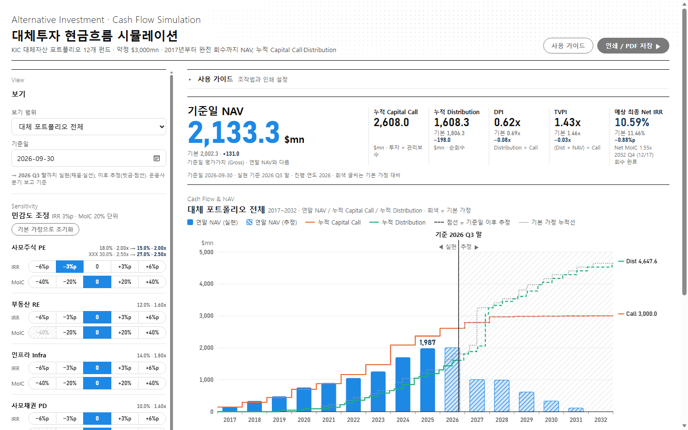
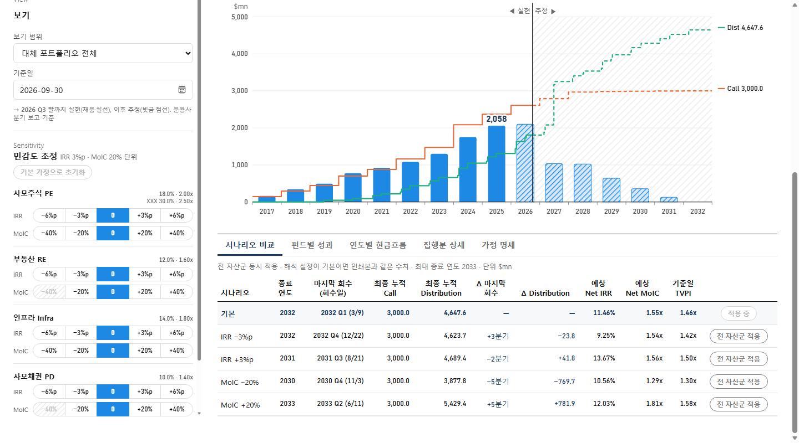
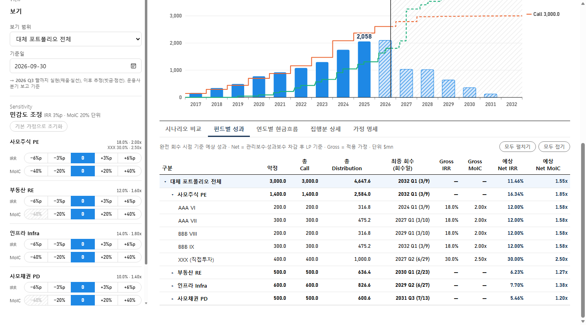

# 대체투자 현금흐름 시뮬레이션 — 사용자 매뉴얼

이 대시보드는 KIC 대체자산 포트폴리오(12개 펀드, 약정 $3,000mn)가 **2017년부터 투자금을 모두 회수할 때까지**
돈이 언제 나가고(Capital Call) 언제 들어오는지(Distribution), 그리고 남아 있는 자산 가치(NAV)가 어떻게 변하는지 보여줍니다.
**IRR(수익률)과 MoIC(회수 배수) 가정을 바꾸면** 결과가 어떻게 달라지는지 바로 확인할 수 있습니다.

> 별도 설치 없이 웹 브라우저(Chrome·Edge 권장)로 사용합니다. 입력한 조건은 저장되지 않으며, 새로고침하면 처음 상태로 돌아갑니다.

---

## 1. 열기

| 방법 | 설명 |
|---|---|
| 공유 링크 | 담당자에게 받은 링크를 클릭합니다. 로그인 없이 열립니다 |
| 오프라인 파일 | 담당자에게 받은 HTML 파일을 더블클릭합니다. 인터넷 없이 열립니다 |

화면 오른쪽 위 **사용 가이드** 버튼을 누르면 이 매뉴얼의 요약을 화면 안에서 볼 수 있습니다.

---

## 2. 화면 한눈에 보기

| 위치 | 내용 |
|---|---|
| ① 왼쪽 | **조작 영역** — 무엇을 볼지(보기 범위·기준일)와 가정 조정(민감도) |
| ② 오른쪽 위 | **기준일 NAV**(큰 파란 숫자)와 주요 지표, **예상 최종 Net IRR** |
| ③ 오른쪽 가운데 | **차트** — 연도별 NAV와 누적 입출금 |
| ④ 오른쪽 아래 | **표** — 시나리오 비교 / 펀드별 성과 / 연도별 현금흐름 / 집행분 상세 / 가정 명세 (탭으로 전환) |

왼쪽에서 조작하면 오른쪽 결과가 **즉시** 바뀝니다.

---

## 3. 자주 하는 일

### 3.1 특정 자산군이나 펀드만 보기
1. 왼쪽 **보기 범위**를 누릅니다.
2. `대체 포트폴리오 전체` / 자산군(`사모주식 PE`, `부동산 RE`, `인프라 Infra`, `사모채권 PD`) / 개별 펀드 중 하나를 고릅니다.
3. 펀드를 고르면 차트가 그 펀드의 **약정 연도부터 회수가 끝나는 해까지**만 보입니다.

### 3.2 수익률(IRR)이나 회수 배수(MoIC)를 바꿔 보기

1. 왼쪽 **민감도 조정**에서 자산군 줄을 찾습니다.
2. **IRR** 버튼(−6%p ~ +6%p) 또는 **MoIC** 버튼(−40% ~ +40%)을 누릅니다. 파란 버튼이 현재 선택입니다.
3. 결과를 확인합니다.
   - 큰 숫자와 지표 아래에 **기본 대비 증감**(예: PE IRR −3%p 선택 시 `기본 2,002.3 · +131.0`)이 나옵니다.
   - 차트에 **회색 선**으로 원래(기본 가정) 결과가 함께 그려집니다.
   - 차트는 이전 모양에서 새 결과로 부드럽게 바뀌며, 차트 위치는 그대로입니다.
   - 표에는 괄호 안에 원래 값이 나옵니다.
4. 되돌리려면 **기본 가정으로 초기화**를 누릅니다.

- IRR과 MoIC를 동시에 바꿀 수 있고, 자산군마다 따로 바꿀 수 있습니다.
- **빗금 친 버튼은 누를 수 없습니다.** 조정 후 IRR이 1% 미만이거나 MoIC가 1.0배 이하(원금 손실)가 되는 경우입니다. 이유는 `비활성 단계`를 펼치면 보입니다.

### 3.3 대표 시나리오 5개를 한 번에 비교하기

1. 차트 아래 **시나리오 비교** 탭을 봅니다.
2. 기본 / IRR −3%p / IRR +3%p / MoIC −20% / MoIC +20%를 **모든 자산군에 동시에** 적용한 결과가 나옵니다.
3. **Δ 마지막 회수**: 기본보다 회수가 몇 **분기** 늦어지는지(+) 빨라지는지(−) 보여줍니다(예: `+3분기`).
4. **Δ Distribution**: 기본보다 돌려받는 돈이 얼마나 늘거나 주는지 보여줍니다.
5. **예상 Net IRR · Net MoIC**: 그 시나리오로 모두 회수했을 때 보수를 뗀 최종 수익률과 배수입니다.
6. 행 오른쪽 **전 자산군 적용**을 누르면 그 시나리오가 화면 전체에 반영됩니다.

### 3.4 펀드별 최종 수익률 보기

1. 표의 **펀드별 성과** 탭을 누릅니다. 처음에는 전체와 자산군 4개만 보입니다.
   - 행 앞 **▸** 를 누르면 그 자산군의 펀드가 펼쳐지고, **▾** 를 누르면 접힙니다.
   - 맨 위 "대체 포트폴리오 전체"를 접으면 전체 한 줄만 남습니다. **모두 펼치기 / 모두 접기** 버튼도 있습니다.
2. 전체 · 자산군 · 펀드마다 약정, 총 Call, 총 Distribution, 최종 회수 분기(실제 회수일)와 **예상 Net IRR · Net MoIC**가 나옵니다.
3. **Net**은 관리보수(매년 약정의 2%, 집행기간 후 1%)와 성과보수(이익의 20%)를 뗀, KIC가 실제로 받는 기준입니다. 같은 줄의 Gross IRR·MoIC(가정값)와 비교해 보수의 영향을 볼 수 있습니다.
4. 가정을 바꾸면 괄호 안에 원래 값이 함께 나옵니다.

### 3.5 기준일 바꾸기
1. 왼쪽 **기준일** 날짜를 바꿉니다. 처음 열면 2026-09-30(2026 Q3 말)입니다.
2. 운용사는 분기마다 보고하므로, 그 날짜 **직전 분기 말까지**가 실현으로 잡힙니다. 날짜 아래에 `→ 2026 Q3 말까지 실현`처럼 표시됩니다(분기 말 당일이면 그 분기 포함).
3. 실현 구간은 채움·실선, 이후는 빗금·점선으로 바뀌고 주요 지표도 그 분기 말 기준으로 다시 계산됩니다.

### 3.6 계산 방식 설정 바꾸기 (선택)

왼쪽 아래 **해석 설정**을 펼칩니다. 보통은 바꿀 필요가 없습니다.

| 항목 | 기본값 | 다른 선택 |
|---|---|---|
| IRR 조정 해석 | %p 가감 (18% → 15%) | 상대 변동 (18% → 17.46%) |
| MoIC 조정 해석 | 상대 변동 (2.0x → 1.6x) | 절대 가감 (2.0x → 1.8x) |
| NAV 기준 | Gross (평가가치 그대로) | Net (성과보수 예상분 차감) |
| XXX 연동 | PE 조정을 직접투자 XXX에도 적용 | 적용 안 함 |

### 3.7 인쇄하거나 PDF로 저장하기

1. 오른쪽 위 **인쇄 / PDF 저장**을 누릅니다.
2. 인쇄 창에서 다음과 같이 고릅니다.
   - **PDF로 저장**할 때: 그대로 저장
   - **프린터** 또는 **Microsoft Print to PDF**로 보낼 때: **레이아웃 "가로"**, **용지 "A4"**를 꼭 선택
   - 배율은 "기본", 배경 그래픽은 켜기
3. 인쇄물은 **A4 가로 2장**으로 나옵니다. 1장은 포트폴리오 전체, 2장은 PE 펀드 AAA VII입니다.

인쇄물은 화면에서 바꾼 조건과 관계없이 **항상 같은 조건**으로 나옵니다(기준일 2026-09-30 = 2026 Q3 말, 대표 시나리오 5개). 요약 표에 시나리오별 예상 Net IRR·MoIC가 함께 나옵니다.

---

## 4. 차트 읽는 법

| 모양 | 의미 |
|---|---|
| 파란 막대 (꽉 찬) | 그해 말 NAV — 이미 지난 해(실현) |
| 파란 막대 (빗금) | 그해 말 NAV — 앞으로의 예상(추정) |
| 주황 계단선 | 누적 Capital Call (지금까지 낸 돈: 투자금 + 관리보수). 최종적으로 약정액과 같아짐 |
| 초록 계단선 | 누적 Distribution (지금까지 돌려받은 돈: 성과보수 뺀 금액) |
| 실선 / 점선 | 기준 분기 말 이전 / 이후 |
| 세로선과 오른쪽 빗금 배경 | 기준 분기 말(예: 기준 2026 Q3 말)과 그 이후 예상 구간 |
| 회색 선 | 가정을 바꿨을 때 원래(기본 가정) 결과 |
| 막대 위 숫자 | 가장 최근 실현 연도의 NAV |

- 연도 위에 마우스를 올리면 그해의 자세한 숫자가 뜹니다.
- 계단선은 돈이 실제로 오간 **날짜**에 계단이 생깁니다. 투자·관리보수는 매년 1월 1일, 회수는 목표 배수에 도달한 날(회수일)입니다. 그래서 같은 해 안에서 회수가 늦어지거나 빨라지는 것도 보입니다.

---

## 5. 용어 풀이

| 용어 | 뜻 |
|---|---|
| 약정 (Commitment) | 펀드에 투자하기로 약속한 총액 |
| Capital Call | 실제로 펀드에 납입한 돈 (투자금 + 관리보수). 보수까지 포함해 **약정액을 넘지 않음** (전체 최종 3,000) |
| Distribution | 펀드에서 돌려받은 돈 (회수액에서 성과보수를 뺀 금액) |
| NAV | 아직 회수하지 않은 투자의 평가 가치 |
| 기준일 NAV | 기준 분기 말(기준일 직전 분기 말)의 평가 가치. 연말 NAV와 날짜가 달라 값이 다를 수 있음 |
| 연말 NAV | 각 연도 12월 31일 기준 평가 가치 (차트 막대) |
| IRR | 연 수익률. 높을수록 목표 배수에 빨리 도달 → **회수가 빨라짐** |
| MoIC | 원금 대비 회수 배수 (2.0x = 원금의 2배). 높을수록 더 오래 보유 → **회수가 늦어짐** |
| DPI | 돌려받은 돈 ÷ 낸 돈 |
| TVPI | (돌려받은 돈 + 남은 가치) ÷ 낸 돈 |
| 예상 Net IRR | 모두 회수했을 때, 낸 돈(투자금 + 관리보수)과 돌려받은 돈(성과보수 차감)으로 계산한 연 수익률 |
| 예상 Net MoIC | 모두 회수했을 때 돌려받은 돈 ÷ 낸 돈 |
| Gross / Net | 보수를 빼기 전(가정값) / 관리보수·성과보수를 뺀 후 |
| 실현 / 추정 | 기준 분기 말 이전(이미 보고된 기간) / 이후(예상) |
| 집행분 | 매년 1월 1일 실제로 투자되는 한 덩어리 = (약정 − 총 관리보수) ÷ 집행기간 |
| 회수 표기 | `2027 Q2 (6/29)` = 2027년 2분기, 실제 회수일 6월 29일. 보고·집계는 분기 단위 |
| 회수일 | 목표 배수(MoIC)에 도달해 매각·회수하는 날 (과제 가정 4) |
| 마지막 회수 분기 | 마지막 집행분을 회수하는 분기 (예: 2032 Q1 (3/9)) |

---

## 6. 자주 묻는 질문

**Q. 가정을 바꿨는데 과거(실현) 막대도 바뀝니다. 정상인가요?**
네. 민감도는 가정을 투자 시점부터 다시 적용하는 **가상 시나리오**(처음부터 그 수익률이었다면)입니다. 과거는 실제 보고값으로 두고 앞으로만 바꿔 보는 기능은 실적 데이터가 들어온 뒤에 추가할 수 있습니다.

**Q. IRR을 바꿨는데 연도별 표 숫자가 그대로입니다.**
회수 **연도**는 같고 연도 안에서 **분기**만 달라진 경우입니다(예: 2024 Q1 → 2024 Q4). 차트의 계단선, 시나리오 비교의 `Δ 마지막 회수`, 집행분 상세의 회수 분기와 괄호 안 회수일에서 차이를 볼 수 있습니다. 같은 분기 안에서 움직이면 회수일만 달라집니다.

**Q. 큰 파란 숫자(기준일 NAV)와 차트 막대 값이 다릅니다.**
큰 숫자는 **기준 분기 말**(예: 2026 Q3 말), 막대는 **각 연도 말** 기준이라 다릅니다.

**Q. Net IRR이 가정 IRR(Gross)보다 많이 낮습니다.**
정상입니다. 관리보수가 약정액 기준으로 매년 나가고(그만큼 투자금이 줄어듦), 회수 때 이익의 20%가 성과보수로 빠지기 때문입니다. 예를 들어 AAA VII은 Gross 18% · 2.00x → Net 12.00% · 1.58x입니다. 보수가 없는 직접투자 XXX는 가정과 같은 Net 30.00% · 2.50x입니다.

**Q. 일부 버튼이 빗금으로 눌리지 않습니다.**
그 조정을 하면 수익률이 1% 미만이 되거나 원금을 잃게(배수 1.0 이하) 되는 경우입니다. 이런 손실 상황의 계산 규칙은 과제 조건에 없어 막아 두었습니다.

**Q. 인쇄했더니 옆으로 누운 PDF가 나옵니다.**
인쇄 창에서 **레이아웃을 "가로"**로 바꾸어 다시 인쇄하십시오. "PDF로 저장"을 쓰면 이 설정 없이도 바르게 저장됩니다.

**Q. 내가 바꾼 조건을 저장하거나 다른 사람에게 보낼 수 있나요?**
조건 저장 기능은 없습니다. 보기 범위는 주소 끝에 붙여 공유할 수 있습니다(예: 주소 뒤에 `#fund:AAA_VII`, `#class:PE`). 결과를 남기려면 PDF로 저장하십시오.

---

## 7. 알아 두실 점

- 이 시뮬레이션은 과제에서 주어진 **가정**(약정·집행기간·IRR·MoIC·보수율)으로 계산합니다. 실제 운용 실적 데이터는 들어 있지 않습니다.
- 매년 1월 1일 균등 투자, 목표 배수에 도달한 날 전액 회수(보고는 분기 단위), 관리보수는 약정 안에서 충당(투자금 = 약정 − 총 관리보수) 등 단순화된 규칙을 따릅니다. 자세한 규칙은 화면의 **가정 명세** 탭에서 볼 수 있습니다.
- 모든 계산은 사용자의 브라우저 안에서 이루어지며, 입력 내용은 어디로도 전송되지 않습니다.
