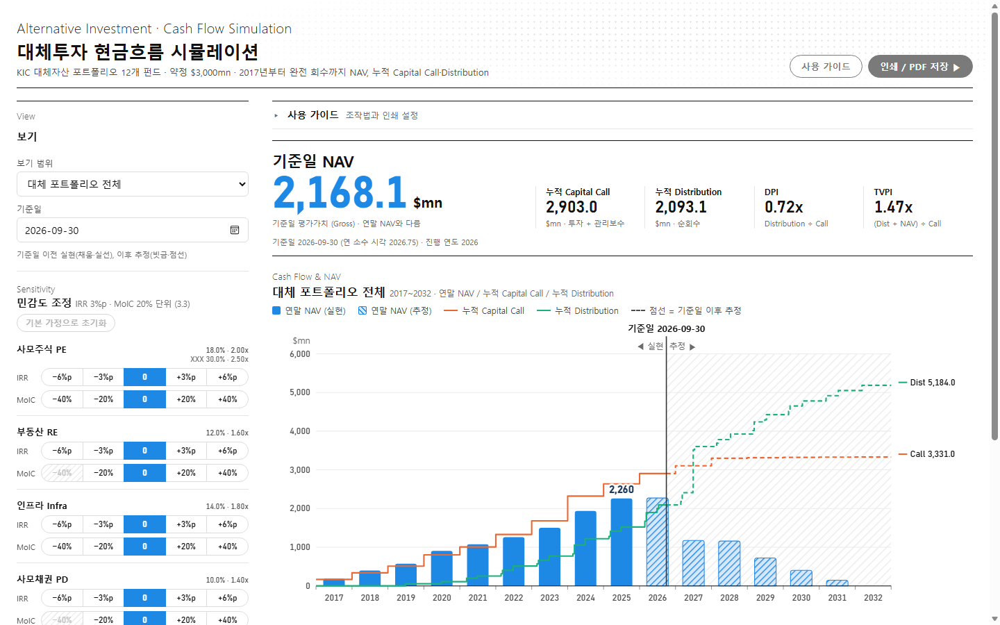
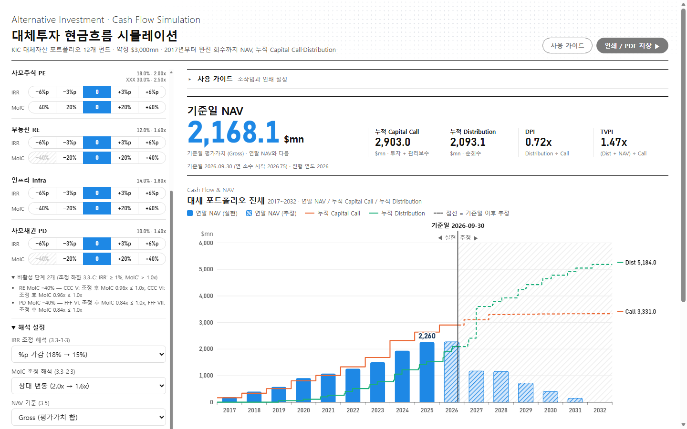
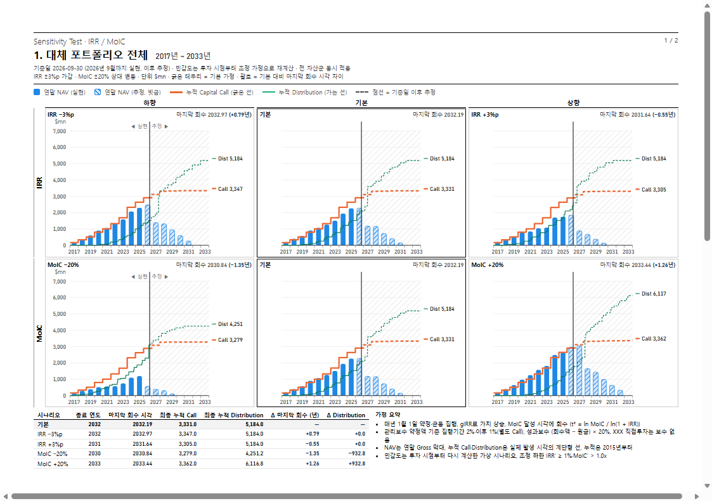

# 대체투자 현금흐름 시뮬레이션 — 사용자 매뉴얼

이 대시보드는 KIC 대체자산 포트폴리오(12개 펀드, 약정 $3,000mn)가 **2017년부터 투자금을 모두 회수할 때까지**
돈이 언제 나가고(Capital Call) 언제 들어오는지(Distribution), 그리고 남아 있는 자산 가치(NAV)가 어떻게 변하는지 보여줍니다.
**IRR(수익률)과 MoIC(회수 배수) 가정을 바꾸면** 결과가 어떻게 달라지는지 바로 확인할 수 있습니다.

> 별도 설치 없이 웹 브라우저(Chrome·Edge 권장)로 사용합니다. 입력한 조건은 저장되지 않으며, 새로고침하면 처음 상태로 돌아갑니다.

---

## 1. 열기

| 방법 | 설명 |
|---|---|
| 공유 링크 | 담당자에게 받은 링크를 클릭합니다. 로그인 없이 열립니다 |
| 오프라인 파일 | 담당자에게 받은 HTML 파일을 더블클릭합니다. 인터넷 없이 열립니다 |

화면 오른쪽 위 **사용 가이드** 버튼을 누르면 이 매뉴얼의 요약을 화면 안에서 볼 수 있습니다.

---

## 2. 화면 한눈에 보기

| 위치 | 내용 |
|---|---|
| ① 왼쪽 | **조작 영역** — 무엇을 볼지(보기 범위·기준일)와 가정 조정(민감도) |
| ② 오른쪽 위 | **기준일 NAV**(큰 파란 숫자)와 주요 지표 |
| ③ 오른쪽 가운데 | **차트** — 연도별 NAV와 누적 입출금 |
| ④ 오른쪽 아래 | **표** — 시나리오 비교 / 연도별 현금흐름 / 집행분 상세 / 가정 명세 (탭으로 전환) |

왼쪽에서 조작하면 오른쪽 결과가 **즉시** 바뀝니다.

---

## 3. 자주 하는 일

### 3.1 특정 자산군이나 펀드만 보기
1. 왼쪽 **보기 범위**를 누릅니다.
2. `대체 포트폴리오 전체` / 자산군(`사모주식 PE`, `부동산 RE`, `인프라 Infra`, `사모채권 PD`) / 개별 펀드 중 하나를 고릅니다.
3. 펀드를 고르면 차트가 그 펀드의 **약정 연도부터 회수가 끝나는 해까지**만 보입니다.

### 3.2 수익률(IRR)이나 회수 배수(MoIC)를 바꿔 보기

1. 왼쪽 **민감도 조정**에서 자산군 줄을 찾습니다.
2. **IRR** 버튼(−6%p ~ +6%p) 또는 **MoIC** 버튼(−40% ~ +40%)을 누릅니다. 파란 버튼이 현재 선택입니다.
3. 결과를 확인합니다.
   - 큰 숫자와 지표 아래에 **기본 대비 증감**(예: `기본 2,168.1 · +155.9`)이 나옵니다.
   - 차트에 **회색 선**으로 원래(기본 가정) 결과가 함께 그려집니다.
   - 표에는 괄호 안에 원래 값이 나옵니다.
4. 되돌리려면 **기본 가정으로 초기화**를 누릅니다.

- IRR과 MoIC를 동시에 바꿀 수 있고, 자산군마다 따로 바꿀 수 있습니다.
- **빗금 친 버튼은 누를 수 없습니다.** 조정 후 IRR이 1% 미만이거나 MoIC가 1.0배 이하(원금 손실)가 되는 경우입니다. 이유는 `비활성 단계`를 펼치면 보입니다.

### 3.3 대표 시나리오 5개를 한 번에 비교하기

1. 차트 아래 **시나리오 비교** 탭을 봅니다.
2. 기본 / IRR −3%p / IRR +3%p / MoIC −20% / MoIC +20%를 **모든 자산군에 동시에** 적용한 결과가 나옵니다.
3. **Δ 마지막 회수(년)**: 기본보다 회수가 몇 년 늦어지는지(+) 빨라지는지(−) 보여줍니다.
4. **Δ Distribution**: 기본보다 돌려받는 돈이 얼마나 늘거나 주는지 보여줍니다.
5. 행 오른쪽 **전 자산군 적용**을 누르면 그 시나리오가 화면 전체에 반영됩니다.

### 3.4 기준일 바꾸기
1. 왼쪽 **기준일** 날짜를 바꿉니다.
2. 기준일 **이전**은 이미 일어난 것(실현), **이후**는 예상(추정)으로 표시가 바뀝니다.
3. 주요 지표도 그 날짜 기준으로 다시 계산됩니다.

### 3.5 계산 방식 설정 바꾸기 (선택)

왼쪽 아래 **해석 설정**을 펼칩니다. 보통은 바꿀 필요가 없습니다.

| 항목 | 기본값 | 다른 선택 |
|---|---|---|
| IRR 조정 해석 | %p 가감 (18% → 15%) | 상대 변동 (18% → 17.46%) |
| MoIC 조정 해석 | 상대 변동 (2.0x → 1.6x) | 절대 가감 (2.0x → 1.8x) |
| NAV 기준 | Gross (평가가치 그대로) | Net (성과보수 예상분 차감) |
| 민감도 모드 | 전 구간 재계산 | 실무 모드 (기준일 이전은 원래 가정 그대로 두고 이후만 변경) |
| XXX 연동 | PE 조정을 직접투자 XXX에도 적용 | 적용 안 함 |

### 3.6 인쇄하거나 PDF로 저장하기

1. 오른쪽 위 **인쇄 / PDF 저장**을 누릅니다.
2. 인쇄 창에서 다음과 같이 고릅니다.
   - **PDF로 저장**할 때: 그대로 저장
   - **프린터** 또는 **Microsoft Print to PDF**로 보낼 때: **레이아웃 "가로"**, **용지 "A4"**를 꼭 선택
   - 배율은 "기본", 배경 그래픽은 켜기
3. 인쇄물은 **A4 가로 2장**으로 나옵니다. 1장은 포트폴리오 전체, 2장은 PE 펀드 AAA VII입니다.

인쇄물은 화면에서 바꾼 조건과 관계없이 **항상 같은 조건**으로 나옵니다(기준일 2026-09-30, 대표 시나리오 5개).

---

## 4. 차트 읽는 법

| 모양 | 의미 |
|---|---|
| 파란 막대 (꽉 찬) | 그해 말 NAV — 이미 지난 해(실현) |
| 파란 막대 (빗금) | 그해 말 NAV — 앞으로의 예상(추정) |
| 주황 계단선 | 누적 Capital Call (지금까지 낸 돈: 투자금 + 관리보수) |
| 초록 계단선 | 누적 Distribution (지금까지 돌려받은 돈: 성과보수 뺀 금액) |
| 실선 / 점선 | 기준일 이전 / 이후 |
| 세로선과 오른쪽 빗금 배경 | 기준일과 그 이후 예상 구간 |
| 회색 선 | 가정을 바꿨을 때 원래(기본 가정) 결과 |
| 막대 위 숫자 | 가장 최근 실현 연도의 NAV |

- 연도 위에 마우스를 올리면 그해의 자세한 숫자가 뜹니다.
- 계단선은 실제로 돈이 오간 **시점**에 계단이 생깁니다. 그래서 같은 해 안에서 회수가 조금 늦어지거나 빨라지는 것도 보입니다.

---

## 5. 용어 풀이

| 용어 | 뜻 |
|---|---|
| 약정 (Commitment) | 펀드에 투자하기로 약속한 총액 |
| Capital Call | 실제로 펀드에 납입한 돈 (투자금 + 관리보수) |
| Distribution | 펀드에서 돌려받은 돈 (회수액에서 성과보수를 뺀 금액) |
| NAV | 아직 회수하지 않은 투자의 평가 가치 |
| 기준일 NAV | 기준일 당일의 평가 가치. 연말 NAV와 날짜가 달라 값이 다를 수 있음 |
| 연말 NAV | 각 연도 12월 31일 기준 평가 가치 (차트 막대) |
| IRR | 연 수익률. 높을수록 목표 배수에 빨리 도달 → **회수가 빨라짐** |
| MoIC | 원금 대비 회수 배수 (2.0x = 원금의 2배). 높을수록 더 오래 보유 → **회수가 늦어짐** |
| DPI | 돌려받은 돈 ÷ 낸 돈 |
| TVPI | (돌려받은 돈 + 남은 가치) ÷ 낸 돈 |
| 실현 / 추정 | 기준일 이전(이미 지난 기간) / 이후(예상) |
| 집행분 | 약정금 중 매년 1월 1일 실제로 투자되는 한 덩어리 |
| 마지막 회수 시각 | 마지막 집행분을 회수하는 시점 (예: 2032.19 = 2032년 초에서 0.19년 지난 시점, 약 3월 초) |

---

## 6. 자주 묻는 질문

**Q. 가정을 바꿨는데 과거(실현) 막대도 바뀝니다. 정상인가요?**
네. 기본 설정(전 구간 재계산)은 가정을 투자 시점부터 다시 적용하는 **가상 시나리오**입니다. 과거는 그대로 두고 앞으로만 바꿔 보려면 해석 설정에서 **실무 모드**를 고르십시오.

**Q. IRR을 바꿨는데 연도별 표 숫자가 그대로입니다.**
회수 **연도**는 같고 연도 안에서 **시점**만 달라진 경우입니다. 차트의 계단선, 시나리오 비교의 `Δ 마지막 회수`, 집행분 상세의 회수 시각에서 차이를 볼 수 있습니다.

**Q. 큰 파란 숫자(기준일 NAV)와 차트 막대 값이 다릅니다.**
큰 숫자는 **기준일 당일**, 막대는 **각 연도 말** 기준이라 다릅니다.

**Q. 일부 버튼이 빗금으로 눌리지 않습니다.**
그 조정을 하면 수익률이 1% 미만이 되거나 원금을 잃게(배수 1.0 이하) 되는 경우입니다. 이런 손실 상황의 계산 규칙은 과제 조건에 없어 막아 두었습니다.

**Q. 인쇄했더니 옆으로 누운 PDF가 나옵니다.**
인쇄 창에서 **레이아웃을 "가로"**로 바꾸어 다시 인쇄하십시오. "PDF로 저장"을 쓰면 이 설정 없이도 바르게 저장됩니다.

**Q. 내가 바꾼 조건을 저장하거나 다른 사람에게 보낼 수 있나요?**
조건 저장 기능은 없습니다. 보기 범위는 주소 끝에 붙여 공유할 수 있습니다(예: 주소 뒤에 `#fund:AAA_VII`, `#class:PE`). 결과를 남기려면 PDF로 저장하십시오.

---

## 7. 알아 두실 점

- 이 시뮬레이션은 과제에서 주어진 **가정**(약정·집행기간·IRR·MoIC·보수율)으로 계산합니다. 실제 운용 실적 데이터는 들어 있지 않습니다.
- 매년 1월 1일 균등 투자, 목표 배수 도달 시 전액 회수 등 단순화된 규칙을 따릅니다. 자세한 규칙은 화면의 **가정 명세** 탭에서 볼 수 있습니다.
- 모든 계산은 사용자의 브라우저 안에서 이루어지며, 입력 내용은 어디로도 전송되지 않습니다.
